# Jarkom-Modul-5-2026-K-56

| No  | Nama                           | NRP        | Pengerjaan |
| --- | ------------------------------ | ---------- | ---------- |
| 1   | Sahira Bilqis Rivadito         | 5027251037 | 1 - 10     |
| 2   | Muhammmad Ridwan               | 5027251113 | 11 - 20    |

## LAPORAN RESMI MODUL 5

# SOAL 0 | Topologi

---
# SOAL 1 | Perancangan Alamat IP (VLSM) dan Pohon Subnet

Pengalamatan jaringan kelompok K-56 dilakukan menggunakan metode **VLSM (Variable Length Subnet Masking)** dengan blok jaringan `192.239.0.0/21`. Metode VLSM digunakan untuk menentukan ukuran subnet berdasarkan kebutuhan jumlah host pada setiap jaringan sehingga penggunaan alamat IP menjadi lebih efisien.

Ketentuan yang digunakan dalam pembagian alamat IP adalah sebagai berikut:

- **Kebutuhan usable LAN**: jumlah host klien + 1 interface router sebagai gateway.
- **Kebutuhan usable link point-to-point**: 2 interface router.
- **Kebutuhan minimum alamat IP**: jumlah IP usable + 2 alamat untuk Network ID dan Broadcast.
- **Urutan alokasi**: subnet dengan kebutuhan blok terbesar dialokasikan terlebih dahulu, kemudian dilanjutkan dengan blok yang lebih kecil. Pada ukuran blok yang sama, subnet LAN diprioritaskan sebelum link antar-router.

#### Penentuan Prefix Blok Utama

Berdasarkan kebutuhan masing-masing subnet, diperoleh total kebutuhan alamat IP sebagai berikut:

| Prefix | Jumlah Subnet | Kapasitas Blok | Total IP |
|---|---:|---:|---:|
| /23 | 1 | 512 | 512 |
| /24 | 1 | 256 | 256 |
| /25 | 1 | 128 | 128 |
| /26 | 1 | 64 | 64 |
| /27 | 3 | 32 | 96 |
| /28 | 1 | 16 | 16 |
| /29 | 6 | 8 | 48 |
| /30 | 19 | 4 | 76 |
| **Total** | **33** | | **1196** |

Jumlah bit host ditentukan berdasarkan kapasitas minimum yang dapat menampung seluruh kebutuhan alamat IP.

- 2¹⁰ = 1024 IP, belum mencukupi.
- 2¹¹ = 2048 IP, mencukupi.

Dengan demikian:

```math
Prefix = 32 - 11 = 21
```

Blok jaringan minimum yang digunakan adalah `192.239.0.0/21` dengan rincian:

- **Network ID:** `192.239.0.0`
- **Prefix:** `/21`
- **Netmask:** `255.255.248.0`
- **Total alamat IP:** `2048`
- **Broadcast:** `192.239.7.255`
- **Total IP dalam blok teralokasi:** `1196`
- **Total IP belum dialokasikan:** `852`

#### Contoh Perhitungan Subnet (Switch-Quarters)

Subnet `Switch-Quarters` memiliki kebutuhan sebanyak 500 host klien dan terhubung dengan router `Rei` sebagai gateway.

1. Jumlah alamat IP usable yang dibutuhkan:

   `500 host + 1 gateway = 501 IP`

2. Jumlah alamat IP minimum setelah menambahkan Network ID dan Broadcast:

   `501 + 2 = 503 IP`

3. Penentuan ukuran subnet:

   - Prefix `/24` memiliki kapasitas 256 alamat IP dengan 254 IP usable sehingga belum memenuhi kebutuhan.
   - Prefix `/23` memiliki kapasitas 512 alamat IP dengan 510 IP usable sehingga dapat memenuhi kebutuhan 501 alamat IP.

4. Karena Switch-Quarters memiliki kebutuhan blok IP terbesar, subnet tersebut dialokasikan pertama pada blok jaringan kelompok.

Hasil perhitungan subnet Switch-Quarters adalah sebagai berikut:

- **Network ID:** `192.239.0.0`
- **Prefix / Netmask:** `/23` (`255.255.254.0`)
- **Gateway (Rei):** `192.239.0.1`
- **Range IP Usable:** `192.239.0.1 - 192.239.1.254`
- **Broadcast:** `192.239.1.255`
- **IP Terpakai:** `501`
- **IP Sisa:** `510 - 501 = 9 IP`

#### Tabel Pembagian Alamat IP (33 Subnet)

| ID | Nama Subnet | Tipe | Network ID | Prefix | Netmask | Gateway / First IP | Broadcast | IP Terpakai | IP Sisa |
|---|---|---|---|---|---|---|---|---:|---:|
| A1 | Switch-Quarters | LAN | 192.239.0.0 | /23 | 255.255.254.0 | 192.239.0.1 | 192.239.1.255 | 501 | 9 |
| A2 | Switch-Comm | LAN | 192.239.2.0 | /24 | 255.255.255.0 | 192.239.2.1 | 192.239.2.255 | 201 | 53 |
| A3 | Switch-Hangar | LAN | 192.239.3.0 | /25 | 255.255.255.128 | 192.239.3.1 | 192.239.3.127 | 101 | 25 |
| A4 | Switch-Bunker | LAN | 192.239.3.128 | /26 | 255.255.255.192 | 192.239.3.129 | 192.239.3.191 | 56 | 6 |
| A5 | Switch-Medic | LAN | 192.239.3.192 | /27 | 255.255.255.224 | 192.239.3.193 | 192.239.3.223 | 27 | 3 |
| A6 | Switch-Relay | LAN | 192.239.3.224 | /27 | 255.255.255.224 | 192.239.3.225 | 192.239.3.255 | 26 | 4 |
| A7 | Switch-Garden | LAN | 192.239.4.0 | /27 | 255.255.255.224 | 192.239.4.1 | 192.239.4.31 | 15 | 15 |
| A8 | Switch-Dock | LAN | 192.239.4.32 | /28 | 255.255.255.240 | 192.239.4.33 | 192.239.4.47 | 13 | 1 |
| A9 | Switch-Lab | LAN | 192.239.4.48 | /29 | 255.255.255.248 | 192.239.4.49 | 192.239.4.55 | 6 | 0 |
| A10 | Switch-Terminal | LAN | 192.239.4.56 | /29 | 255.255.255.248 | 192.239.4.57 | 192.239.4.63 | 4 | 2 |
| A11 | Switch-Cage | LAN | 192.239.4.64 | /29 | 255.255.255.248 | 192.239.4.65 | 192.239.4.71 | 4 | 2 |
| A12 | Switch-Dogma | LAN | 192.239.4.72 | /29 | 255.255.255.248 | 192.239.4.73 | 192.239.4.79 | 3 | 3 |
| A13 | Switch-Monolith | LAN | 192.239.4.80 | /29 | 255.255.255.248 | 192.239.4.81 | 192.239.4.87 | 3 | 3 |
| A14 | Switch-Radar | LAN | 192.239.4.88 | /29 | 255.255.255.248 | 192.239.4.89 | 192.239.4.95 | 5 | 1 |
| A15 | Switch-Archive | LAN | 192.239.4.96 | /30 | 255.255.255.252 | 192.239.4.97 | 192.239.4.99 | 2 | 0 |
| A16 | Switch-Intel | LAN | 192.239.4.100 | /30 | 255.255.255.252 | 192.239.4.101 | 192.239.4.103 | 2 | 0 |
| A17 | Switch-Cmd | LAN | 192.239.4.104 | /30 | 255.255.255.252 | 192.239.4.105 | 192.239.4.107 | 2 | 0 |
| A18 | Gendo - Yui | Link | 192.239.4.108 | /30 | 255.255.255.252 | 192.239.4.109 | 192.239.4.111 | 2 | 0 |
| A19 | Gendo - Hikari | Link | 192.239.4.112 | /30 | 255.255.255.252 | 192.239.4.113 | 192.239.4.115 | 2 | 0 |
| A20 | Gendo - Asuka | Link | 192.239.4.116 | /30 | 255.255.255.252 | 192.239.4.117 | 192.239.4.119 | 2 | 0 |
| A21 | Gendo - Fuyutsuki | Link | 192.239.4.120 | /30 | 255.255.255.252 | 192.239.4.121 | 192.239.4.123 | 2 | 0 |
| A22 | Gendo - Shigeru | Link | 192.239.4.124 | /30 | 255.255.255.252 | 192.239.4.125 | 192.239.4.127 | 2 | 0 |
| A23 | Gendo - Kaji | Link | 192.239.4.128 | /30 | 255.255.255.252 | 192.239.4.129 | 192.239.4.131 | 2 | 0 |
| A24 | Gendo - Misato | Link | 192.239.4.132 | /30 | 255.255.255.252 | 192.239.4.133 | 192.239.4.135 | 2 | 0 |
| A25 | Yui - Mari | Link | 192.239.4.136 | /30 | 255.255.255.252 | 192.239.4.137 | 192.239.4.139 | 2 | 0 |
| A26 | Yui - Rei | Link | 192.239.4.140 | /30 | 255.255.255.252 | 192.239.4.141 | 192.239.4.143 | 2 | 0 |
| A27 | Yui - Shinji | Link | 192.239.4.144 | /30 | 255.255.255.252 | 192.239.4.145 | 192.239.4.147 | 2 | 0 |
| A28 | Hikari - Kaworu | Link | 192.239.4.148 | /30 | 255.255.255.252 | 192.239.4.149 | 192.239.4.151 | 2 | 0 |
| A29 | Asuka - Kensuke | Link | 192.239.4.152 | /30 | 255.255.255.252 | 192.239.4.153 | 192.239.4.155 | 2 | 0 |
| A30 | Asuka - Ritsuko | Link | 192.239.4.156 | /30 | 255.255.255.252 | 192.239.4.157 | 192.239.4.159 | 2 | 0 |
| A31 | Fuyutsuki - Maya | Link | 192.239.4.160 | /30 | 255.255.255.252 | 192.239.4.161 | 192.239.4.163 | 2 | 0 |
| A32 | Fuyutsuki - Toji | Link | 192.239.4.164 | /30 | 255.255.255.252 | 192.239.4.165 | 192.239.4.167 | 2 | 0 |
| A33 | Shigeru - Makoto | Link | 192.239.4.168 | /30 | 255.255.255.252 | 192.239.4.169 | 192.239.4.171 | 2 | 0 |

#### Pohon Alokasi IP (VLSM)

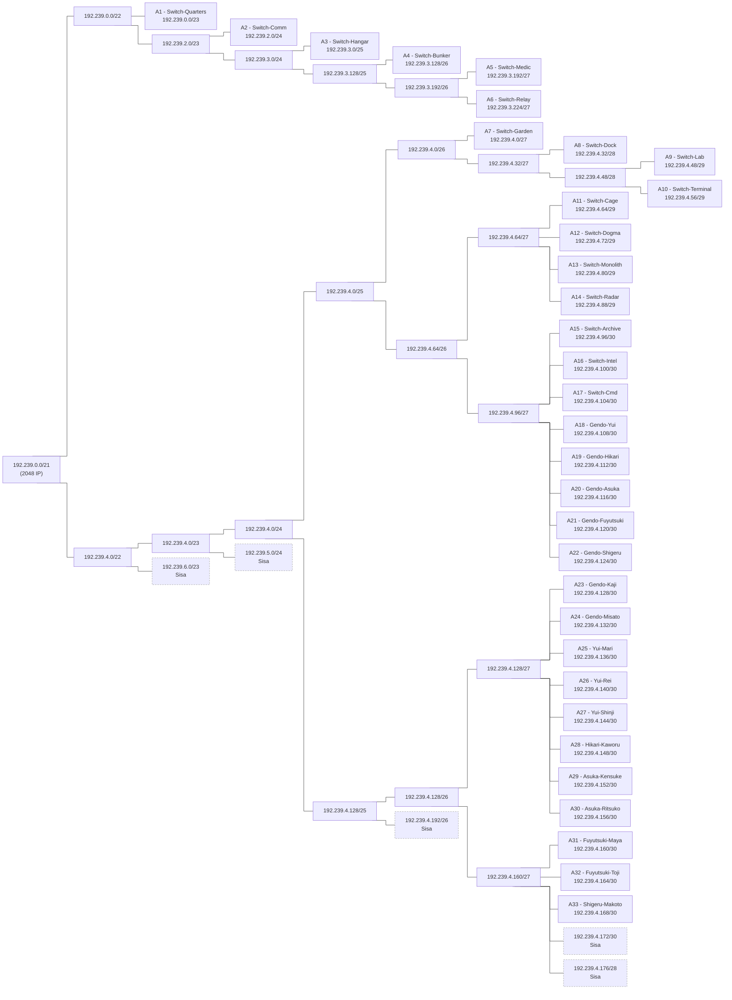

Pohon VLSM tersebut menunjukkan pembagian blok jaringan `192.239.0.0/21` menjadi 33 subnet yang terdiri dari 17 subnet LAN dan 16 subnet link antar-router. Percabangan disederhanakan pada kelompok subnet dengan ukuran yang sama agar diagram lebih mudah dibaca.

Blok alamat IP yang belum dialokasikan adalah sebagai berikut:

| Network ID | Prefix | Jumlah IP |
|---|---|---:|
| 192.239.4.172 | /30 | 4 |
| 192.239.4.176 | /28 | 16 |
| 192.239.4.192 | /26 | 64 |
| 192.239.5.0 | /24 | 256 |
| 192.239.6.0 | /23 | 512 |
| **Total** | | **852** |

#### Jalur Dummy-Plug ke Armisael


Dummy-Plug berada pada subnet A9 (Switch-Lab), sedangkan Armisael berada pada subnet A13 (Switch-Monolith). Berdasarkan topologi jaringan, komunikasi kedua host melewati router Ritsuko, Asuka, Gendo, dan Shigeru.

Urutan subnet yang dilalui dari Dummy-Plug menuju Armisael adalah:

| Urutan | Subnet | Network ID |
|---|---|---|
| 1 | A9 - Switch-Lab | 192.239.4.48/29 |
| 2 | A30 - Asuka-Ritsuko | 192.239.4.156/30 |
| 3 | A20 - Gendo-Asuka | 192.239.4.116/30 |
| 4 | A22 - Gendo-Shigeru | 192.239.4.124/30 |
| 5 | A13 - Switch-Monolith | 192.239.4.80/29 |

Jalur yang dilalui:

**Dummy-Plug → Switch-Lab (192.239.4.48/29) → Ritsuko → Link Asuka-Ritsuko (192.239.4.156/30) → Asuka → Link Gendo-Asuka (192.239.4.116/30) → Gendo → Link Gendo-Shigeru (192.239.4.124/30) → Shigeru → Switch-Monolith (192.239.4.80/29) → Armisael.**

---

# SOAL 2 | Geofront Gelap Gulita

## Konfigurasi IP Address dan IP Forwarding

Pada soal ini dilakukan konfigurasi IP address pada seluruh interface router berdasarkan pembagian subnet VLSM pada Soal 1. Seluruh interface yang digunakan diaktifkan dan IP forwarding diatur menjadi `1` agar router dapat meneruskan paket antarjaringan.

Konfigurasi dilakukan menggunakan script `/root/no2.sh` pada masing-masing router dengan menyesuaikan IP address, prefix, dan interface berdasarkan topologi.

### Konfigurasi Router

Sebagai contoh, berikut konfigurasi `no2.sh` pada router Fuyutsuki:

```sh
#!/bin/sh

# Modul 5 - Soal Nomor 2
# Router: Fuyutsuki

ip link set eth0 up
ip addr replace 192.239.4.122/30 dev eth0

ip link set eth1 up
ip addr replace 192.239.4.57/29 dev eth1

ip link set eth2 up
ip addr replace 192.239.4.161/30 dev eth2

ip link set eth3 up
ip addr replace 192.239.4.165/30 dev eth3

sysctl -w net.ipv4.ip_forward=1
```

Konfigurasi pada router Toji:

```sh
#!/bin/sh
set -e

# Modul 5 - Soal Nomor 2
# Router: Toji

ip link set eth0 up
ip addr replace 192.239.4.166/30 dev eth0

ip link set eth1 up
ip addr replace 192.239.4.73/29 dev eth1

sysctl -w net.ipv4.ip_forward=1
```

Script dengan konfigurasi yang disesuaikan diterapkan pada seluruh 17 router.

```sh
chmod +x /root/no2.sh
./no2.sh
```

Perintah yang digunakan memiliki fungsi sebagai berikut:

| Perintah | Fungsi |
|---|---|
| `ip link set ethX up` | Mengaktifkan interface jaringan |
| `ip addr replace` | Memberikan alamat IP dan prefix pada interface |
| `sysctl -w net.ipv4.ip_forward=1` | Mengaktifkan penerusan paket antar-interface |

### Konfigurasi DHCP Gendou

Interface `eth0` pada router Gendou terhubung langsung dengan NAT1 dan memperoleh alamat IP secara dinamis melalui DHCP.

Pemeriksaan dilakukan menggunakan:

```sh
ip -br a
ip route
```

### Pembuktian

Verifikasi konfigurasi IP address dan IP forwarding dilakukan pada masing-masing router menggunakan:

```sh
ip -br a
sysctl net.ipv4.ip_forward
```

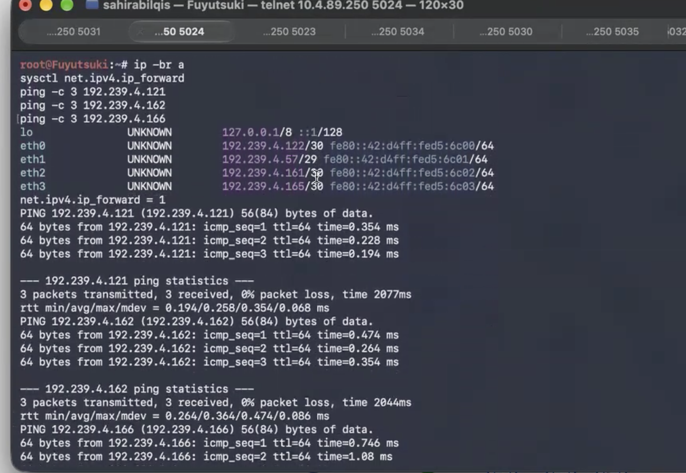

Pengujian konektivitas dilakukan dua arah pada seluruh 16 link antar-router.

| ID | Link Antar-Router | IP Router Pertama | IP Router Kedua |
|---|---|---|---|
| A18 | Gendou - Yui | 192.239.4.109 | 192.239.4.110 |
| A19 | Gendou - Hikari | 192.239.4.113 | 192.239.4.114 |
| A20 | Gendou - Asuka | 192.239.4.117 | 192.239.4.118 |
| A21 | Gendou - Fuyutsuki | 192.239.4.121 | 192.239.4.122 |
| A22 | Gendou - Shigeru | 192.239.4.125 | 192.239.4.126 |
| A23 | Gendou - Kaji | 192.239.4.129 | 192.239.4.130 |
| A24 | Gendou - Misato | 192.239.4.133 | 192.239.4.134 |
| A25 | Yui - Mari | 192.239.4.137 | 192.239.4.138 |
| A26 | Yui - Rei | 192.239.4.141 | 192.239.4.142 |
| A27 | Yui - Shinji | 192.239.4.145 | 192.239.4.146 |
| A28 | Hikari - Kaworu | 192.239.4.149 | 192.239.4.150 |
| A29 | Asuka - Kensuke | 192.239.4.153 | 192.239.4.154 |
| A30 | Asuka - Ritsuko | 192.239.4.157 | 192.239.4.158 |
| A31 | Fuyutsuki - Maya | 192.239.4.161 | 192.239.4.162 |
| A32 | Fuyutsuki - Toji | 192.239.4.165 | 192.239.4.166 |
| A33 | Shigeru - Makoto | 192.239.4.169 | 192.239.4.170 |

Pengujian pada masing-masing router dilakukan menggunakan perintah `ping -c 3` menuju IP router tetangga.

Sebagai contoh, pengujian pada Gendou:

```sh
ping -c 3 192.239.4.110
ping -c 3 192.239.4.114
ping -c 3 192.239.4.118
ping -c 3 192.239.4.122
ping -c 3 192.239.4.126
ping -c 3 192.239.4.130
ping -c 3 192.239.4.134
```

Setiap link diuji dari kedua ujungnya dengan target `0% packet loss`.

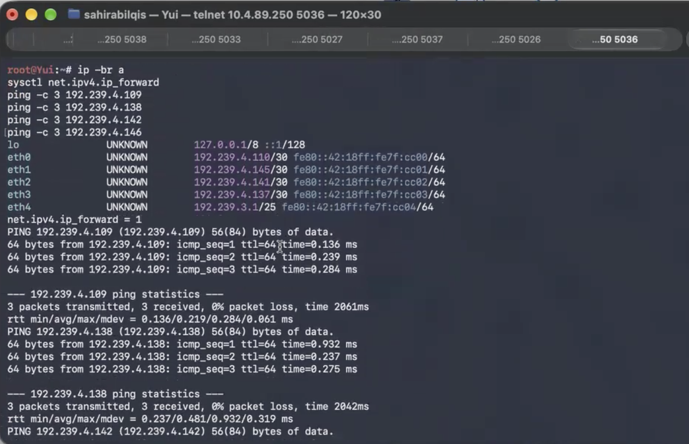

---

# SOAL 3 | Pulau-Pulau yang Terpisah

## Konfigurasi Static Routing

Pada soal ini dilakukan konfigurasi static routing agar seluruh subnet dapat saling berkomunikasi dengan jumlah routing entry sesedikit mungkin.

Router Gendou berperan sebagai router pusat dengan default route menuju NAT1. Router cabang menggunakan default route menuju router induknya dan static route menuju subnet yang berada di bawahnya.

### Pemetaan Default Route

| Router | Router Induk | Next Hop |
|---|---|---|
| Yui | Gendou | 192.239.4.109 |
| Hikari | Gendou | 192.239.4.113 |
| Asuka | Gendou | 192.239.4.117 |
| Fuyutsuki | Gendou | 192.239.4.121 |
| Shigeru | Gendou | 192.239.4.125 |
| Kaji | Gendou | 192.239.4.129 |
| Misato | Gendou | 192.239.4.133 |
| Mari | Yui | 192.239.4.137 |
| Rei | Yui | 192.239.4.141 |
| Shinji | Yui | 192.239.4.145 |
| Kaworu | Hikari | 192.239.4.149 |
| Kensuke | Asuka | 192.239.4.153 |
| Ritsuko | Asuka | 192.239.4.157 |
| Maya | Fuyutsuki | 192.239.4.161 |
| Toji | Fuyutsuki | 192.239.4.165 |
| Makoto | Shigeru | 192.239.4.169 |

### Konfigurasi Script `no3.sh`

Static routing diterapkan menggunakan script `/root/no3.sh` pada masing-masing router.

Berikut konfigurasi routing Shigeru berdasarkan routing table yang digunakan:

```sh
#!/bin/sh
set -e

ip route replace default via 192.239.4.125 dev eth0

ip route replace 192.239.4.88/29 via 192.239.4.170 dev eth2
```

Default route Shigeru diarahkan menuju Gendou. Static route menuju subnet Switch-Radar diarahkan melalui Makoto.

Konfigurasi routing Fuyutsuki:

```sh
#!/bin/sh
set -e

ip route replace default via 192.239.4.121 dev eth0

ip route replace 192.239.3.192/27 via 192.239.4.162 dev eth2

ip route replace 192.239.4.72/29 via 192.239.4.166 dev eth3
```

Fuyutsuki memiliki default route menuju Gendou dan static route menuju jaringan Switch-Medic melalui Maya serta Switch-Dogma melalui Toji.

Perintah `ip route replace` digunakan agar konfigurasi dapat diterapkan kembali tanpa menghasilkan duplikasi routing entry.

Script dijalankan pada masing-masing router:

```sh
chmod +x /root/no3.sh
./no3.sh
```

### Pembuktian

Verifikasi routing table dilakukan pada router pusat dan router cabang menggunakan:

```sh
ip route
```

Routing table aktual pada Shigeru:

```text
default via 192.239.4.125 dev eth0
192.239.4.80/29 dev eth1 proto kernel scope link src 192.239.4.81
192.239.4.88/29 via 192.239.4.170 dev eth2
192.239.4.124/30 dev eth0 proto kernel scope link src 192.239.4.126
192.239.4.168/30 dev eth2 proto kernel scope link src 192.239.4.169
```

### Pengujian Konektivitas Antar-Subnet

Pengujian dilakukan dari Armisael menuju Lilith, Sachiel, dan Comm-Net.

| Node | IP Address | Gateway |
|---|---|---|
| Armisael | 192.239.4.83/29 | 192.239.4.81 |
| Lilith | 192.239.4.74/29 | 192.239.4.73 |
| Sachiel | 192.239.3.130/26 | 192.239.3.129 |
| Comm-Net | 192.239.2.2/24 | 192.239.2.1 |

Alamat Comm-Net disesuaikan dengan konfigurasi aktual host.

Pada Armisael:

```sh
ping -c 3 192.239.4.74
ping -c 3 192.239.3.130
ping -c 3 192.239.2.2
```

Jalur routing yang dilalui:

| Tujuan | Jalur |
|---|---|
| Lilith | Armisael - Shigeru - Gendou - Fuyutsuki - Toji - Lilith |
| Sachiel | Armisael - Shigeru - Gendou - Asuka - Kensuke - Sachiel |
| Comm-Net | Armisael - Shigeru - Gendou - Hikari - Comm-Net |

Hasil yang diharapkan adalah ketiga tujuan dapat dijangkau dengan `0% packet loss`.

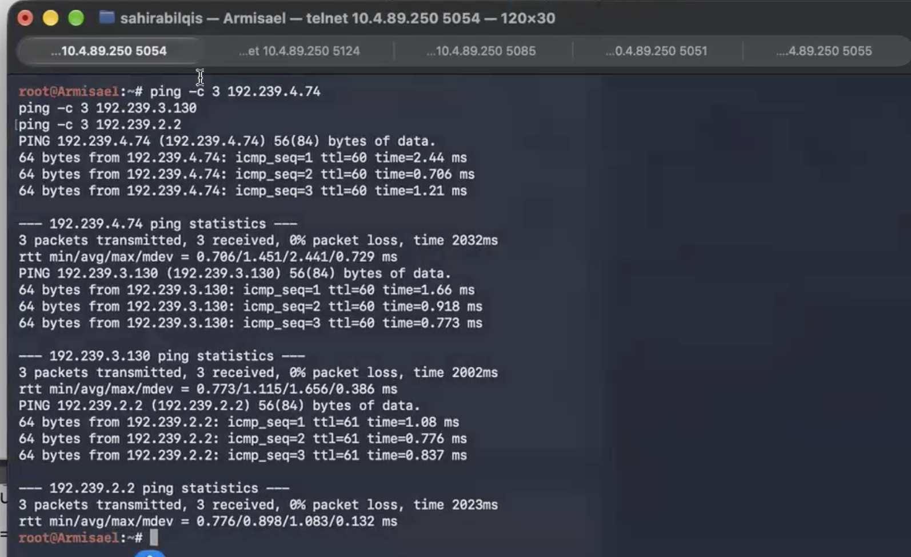

---

# SOAL 4 | Haus Kabar dari Dunia Luar

## Konfigurasi Network Address Translation (NAT)

Pada soal ini dilakukan konfigurasi NAT pada router Gendou agar seluruh jaringan internal dapat mengakses internet melalui NAT1.

Target `MASQUERADE` digunakan karena alamat IP eksternal Gendou diperoleh secara dinamis melalui DHCP sehingga dapat berubah sewaktu-waktu.

### Rancangan NAT

| Parameter | Konfigurasi |
|---|---|
| Router | Gendou |
| Source Network | 192.239.0.0/21 |
| Interface Eksternal | eth0 |
| Tabel | nat |
| Chain | POSTROUTING |
| Target | MASQUERADE |

### Konfigurasi NAT Gendou

Aturan utama NAT yang digunakan:

```sh
iptables -t nat -A POSTROUTING \
-s 192.239.0.0/21 -o eth0 -j MASQUERADE
```

Rule tersebut menerjemahkan alamat sumber paket dari jaringan internal `192.239.0.0/21` hanya ketika paket keluar melalui interface `eth0` menuju NAT1.

Konfigurasi NAT yang telah dibuat diperiksa melalui script:

```sh
cat /root/no4.sh
```

Apabila rule belum aktif, jalankan script konfigurasi NAT yang sesuai:

```sh
./no4.sh
```

### Pembuktian

#### Counter Awal NAT

Pada Gendou:

```sh
iptables -t nat -S
iptables -t nat -L POSTROUTING -n -v
```

#### Pengujian Internet dari Armisael

```sh
ping -c 3 8.8.8.8
ping -c 3 deb.debian.org
```

#### Pengujian Internet dari Lilith

```sh
ping -c 3 8.8.8.8
ping -c 3 deb.debian.org
```

Pengujian menuju `8.8.8.8` digunakan untuk membuktikan konektivitas internet melalui alamat IP. Pengujian menuju `deb.debian.org` digunakan untuk membuktikan bahwa resolusi DNS juga berfungsi.

#### Counter NAT Setelah Pengujian

Kembali pada Gendou:

```sh
iptables -t nat -L POSTROUTING -n -v
```

Kolom `pkts` dan `bytes` pada rule MASQUERADE diharapkan meningkat setelah koneksi baru dari jaringan internal diproses melalui NAT.

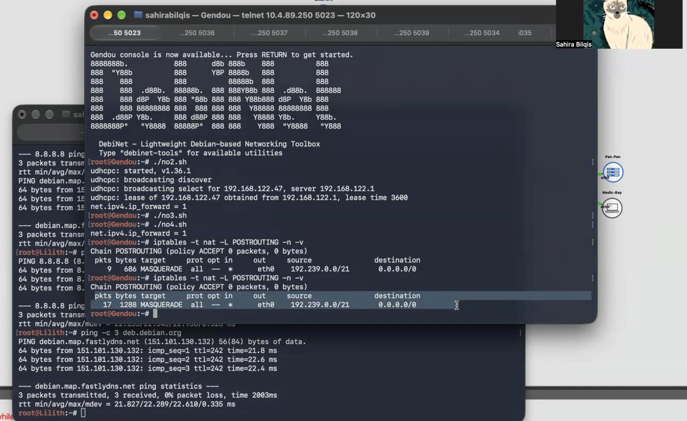

---

# SOAL 5 | Pintu Depan Dikunci Rapat

## Konfigurasi Firewall Gendou

Pada soal ini diterapkan firewall pada router Gendou menggunakan iptables dengan prinsip default deny, yaitu menolak trafik masuk dan trafik forwarding yang tidak memenuhi aturan yang ditentukan.

### Rancangan Kebijakan Firewall

| Chain | Default Policy | Keterangan |
|---|---|---|
| INPUT | DROP | Menolak paket yang ditujukan kepada Gendou kecuali diizinkan |
| FORWARD | DROP | Menolak paket yang melewati Gendou kecuali diizinkan |
| OUTPUT | ACCEPT | Mengizinkan paket yang berasal dari Gendou |

### Konfigurasi Script `gendo.sh`

Firewall diterapkan pada Gendou menggunakan script `/root/gendo.sh`.

```sh
chmod +x /root/gendo.sh
./gendo.sh
```

Berikut aturan firewall yang digunakan berdasarkan konfigurasi aktif pada Gendou:

```sh
iptables -P INPUT DROP
iptables -P FORWARD DROP
iptables -P OUTPUT ACCEPT

iptables -A INPUT \
-m conntrack --ctstate RELATED,ESTABLISHED -j ACCEPT

iptables -A INPUT -i lo -j ACCEPT

iptables -A INPUT -i eth0 \
-p udp --sport 67 --dport 68 -j ACCEPT

iptables -A INPUT \
-s 192.239.0.0/21 ! -i eth0 -j ACCEPT

iptables -A FORWARD \
-m conntrack --ctstate RELATED,ESTABLISHED -j ACCEPT

iptables -A FORWARD \
-s 192.239.0.0/21 ! -i eth0 -o eth0 -j ACCEPT

iptables -A FORWARD \
-s 192.239.0.0/21 -d 192.239.0.0/21 \
! -i eth0 ! -o eth0 -j ACCEPT
```

### Penjelasan Aturan Firewall

| Chain | Rule | Fungsi |
|---|---|---|
| INPUT | ESTABLISHED,RELATED | Mengizinkan paket balasan dari koneksi yang telah terbentuk |
| INPUT | Interface lo | Mengizinkan komunikasi melalui loopback |
| INPUT | UDP source 67 destination 68 | Mengizinkan balasan DHCP dari NAT1 |
| INPUT | Internal, bukan dari eth0 | Mengizinkan jaringan internal mengakses Gendou |
| FORWARD | ESTABLISHED,RELATED | Mengizinkan paket balasan melewati router |
| FORWARD | Internal menuju eth0 | Mengizinkan jaringan internal mengakses internet |
| FORWARD | Internal menuju internal | Mengizinkan komunikasi antar-subnet internal |

### Pembuktian

Pada Gendou:

```sh
iptables -S
```

Hasil pengujian:

```text
-P INPUT DROP
-P FORWARD DROP
-P OUTPUT ACCEPT
-A INPUT -m conntrack --ctstate RELATED,ESTABLISHED -j ACCEPT
-A INPUT -i lo -j ACCEPT
-A INPUT -i eth0 -p udp -m udp --sport 67 --dport 68 -j ACCEPT
-A INPUT -s 192.239.0.0/21 ! -i eth0 -j ACCEPT
-A FORWARD -m conntrack --ctstate RELATED,ESTABLISHED -j ACCEPT
-A FORWARD -s 192.239.0.0/21 ! -i eth0 -o eth0 -j ACCEPT
-A FORWARD -s 192.239.0.0/21 -d 192.239.0.0/21 ! -i eth0 ! -o eth0 -j ACCEPT
```

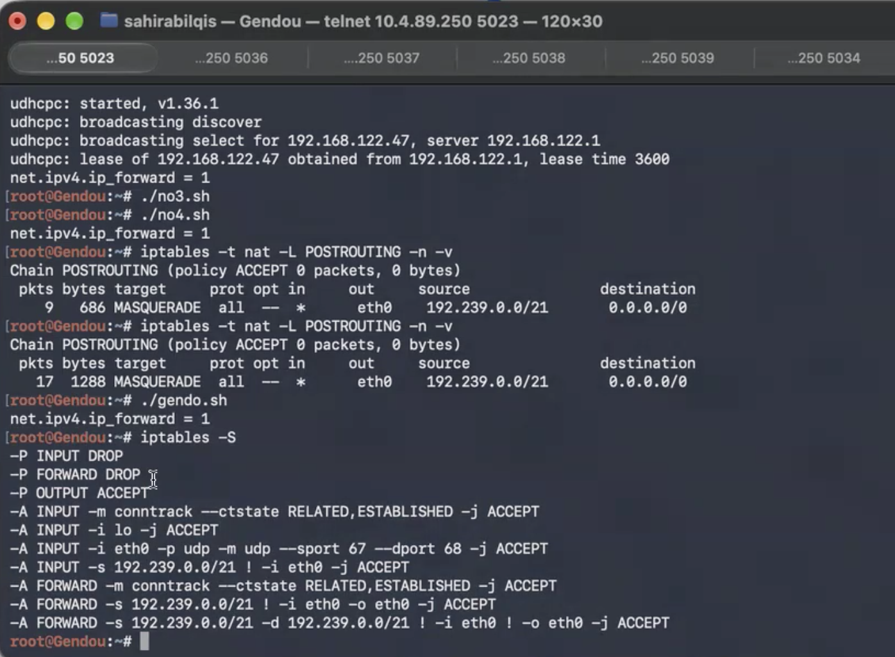

Pengujian akses internet dilakukan pada Armisael:

```sh
ping -c 3 8.8.8.8
```

Meskipun default policy INPUT dan FORWARD menggunakan DROP, jaringan internal tetap diizinkan mengakses internet melalui aturan ACCEPT yang telah ditentukan.

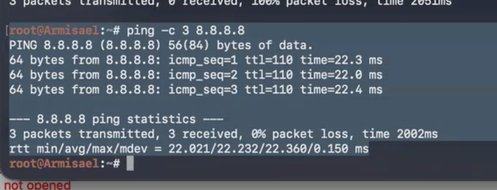

---

# SOAL 6 | Alamat Para Pilot

## Konfigurasi IP Statis pada Node Non-Router

Pada soal ini dilakukan konfigurasi IP address statis dan default gateway pada seluruh node non-router berdasarkan pembagian subnet VLSM.

Konfigurasi disimpan pada script `/root/no6.sh` masing-masing node dengan alamat IP dan gateway yang berbeda sesuai subnet.

### Pemetaan Alamat IP Host

| Node | IP Address | Gateway |
|---|---|---|
| Unit-01 | 192.239.4.66/29 | 192.239.4.65 |
| Unit-02 | 192.239.4.67/29 | 192.239.4.65 |
| Unit-00 | 192.239.4.68/29 | 192.239.4.65 |
| Lilith | 192.239.4.74/29 | 192.239.4.73 |
| Adam | 192.239.4.75/29 | 192.239.4.73 |
| Magi-Casper | 192.239.4.58/29 | 192.239.4.57 |
| Magi-Balthasar | 192.239.4.59/29 | 192.239.4.57 |
| Magi-Melchior | 192.239.4.60/29 | 192.239.4.57 |
| Zeruel | 192.239.4.82/29 | 192.239.4.81 |
| Armisael | 192.239.4.83/29 | 192.239.4.81 |
| Entry-Plug | 192.239.4.50/29 | 192.239.4.49 |
| Dummy-Plug | 192.239.4.51/29 | 192.239.4.49 |
| Spy | 192.239.4.102/30 | 192.239.4.101 |
| Tokyo3-Core | 192.239.4.106/30 | 192.239.4.105 |
| Pen-Pen | 192.239.3.195/27 | 192.239.3.193 |
| Sachiel | 192.239.3.130/26 | 192.239.3.129 |

Node non-router lainnya dikonfigurasi sesuai tabel VLSM pada Soal 1.

### Konfigurasi Script `no6.sh`

Contoh konfigurasi IP statis pada Unit-01:

```sh
#!/bin/sh
set -e

# Modul 5 - Soal Nomor 6
# Node: Unit-01

ip link set eth0 up
ip addr replace 192.239.4.66/29 dev eth0
ip route replace default via 192.239.4.65 dev eth0
```

Konfigurasi pada Magi-Casper:

```sh
#!/bin/sh
set -e

ip link set eth0 up
ip addr replace 192.239.4.58/29 dev eth0
ip route replace default via 192.239.4.57 dev eth0
```

Konfigurasi serupa diterapkan pada seluruh node non-router dengan menyesuaikan alamat IP, prefix, dan default gateway.

```sh
chmod +x /root/no6.sh
./no6.sh
```

Script disimpan pada masing-masing node untuk memudahkan penerapan ulang konfigurasi.

### Pembuktian

Pengujian dilakukan pada Unit-01 yang berada pada subnet Switch-Cage `192.239.4.64/29`.

```sh
ip -br a
ip route
ping -c 3 192.239.4.65
```

Perintah `ip -br a` digunakan untuk menampilkan IP address, sedangkan `ip route` digunakan untuk memastikan default gateway mengarah menuju Misato.

Ping menuju `192.239.4.65` digunakan untuk membuktikan konektivitas Unit-01 dengan gateway.

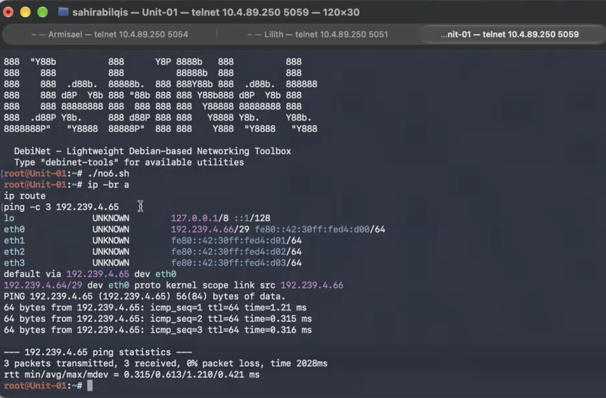

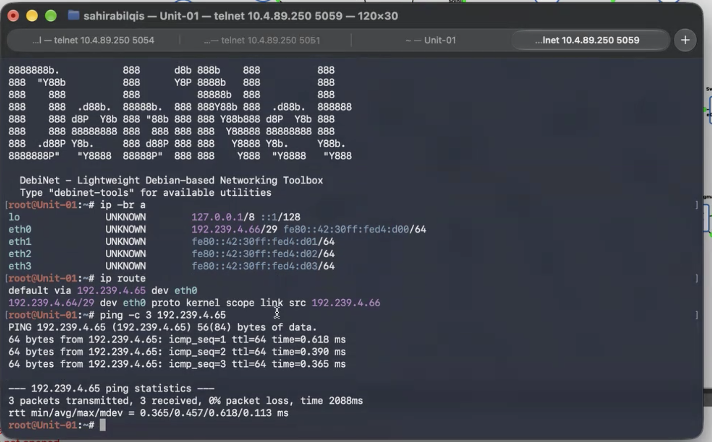

Untuk membuktikan sifat permanen konfigurasi, IP address dan default gateway perlu tetap tersedia setelah node di-restart tanpa menjalankan script secara manual.

---

# SOAL 7 | Membangunkan MAGI

## Instalasi Tools dan Pengujian TCP Listener

Pada soal ini dilakukan instalasi `iptables` dan `netcat-traditional` pada ketiga server MAGI untuk menjalankan TCP listener. Pengujian dilakukan dengan mengirimkan pesan dari Lilith menuju masing-masing server.

### Rancangan Layanan MAGI

| Node | IP Address | Port TCP |
|---|---|---|
| Magi-Casper | 192.239.4.58 | 5000 |
| Magi-Balthasar | 192.239.4.59 | 5001 |
| Magi-Melchior | 192.239.4.60 | 5000 |
| Lilith | 192.239.4.74 | Client |

### Instalasi Package

Instalasi package pada Magi-Casper dilakukan menggunakan script `/root/casper.sh`.

```sh
#!/bin/sh
set -e

# Modul 5 - Soal Nomor 7
# Node: Magi-Casper

apt-get update
apt-get install -y iptables netcat-traditional
```

Jalankan script:

```sh
./casper.sh
```

Pada pengerjaan awal, instalasi package mengalami kegagalan DNS. Konfigurasi jaringan diaktifkan kembali menggunakan:

```sh
./no6.sh
```

Selanjutnya dilakukan instalasi:

```sh
apt update
apt install -y iptables netcat-traditional
```

Meskipun repository Debian Security sempat mengalami kegagalan verifikasi signature, package `netcat-traditional` berhasil diinstal menggunakan daftar package repository utama yang telah terunduh.

Instalasi yang sama dilakukan pada Magi-Balthasar dan Magi-Melchior.

Verifikasi instalasi:

```sh
command -v nc.traditional
iptables --version
```

Hasil:

```text
/usr/bin/nc.traditional
iptables v1.8.11 (nf_tables)
```

Pada Lilith, instalasi Netcat dilakukan menggunakan:

```sh
apt install -y netcat-traditional
```

### Konfigurasi TCP Listener

#### Magi-Casper

```sh
nc.traditional -l -p 5000
```

#### Magi-Balthasar

```sh
nc.traditional -l -p 5001
```

#### Magi-Melchior

```sh
nc.traditional -l -p 5000
```

Ketiga listener dijalankan pada terminal masing-masing server untuk menunggu koneksi TCP dari Lilith.

### Pembuktian

Pengiriman pesan dilakukan dari Lilith menggunakan:

```sh
echo "Hello Casper from Lilith" | nc.traditional -q 1 -w 3 192.239.4.58 5000

echo "Hello Balthasar from Lilith" | nc.traditional -q 1 -w 3 192.239.4.59 5001

echo "Hello Melchior from Lilith" | nc.traditional -q 1 -w 3 192.239.4.60 5000
```

Pesan yang diharapkan muncul pada masing-masing terminal listener:

| Server | Pesan |
|---|---|
| Magi-Casper | Hello Casper from Lilith |
| Magi-Balthasar | Hello Balthasar from Lilith |
| Magi-Melchior | Hello Melchior from Lilith |

Pada pengujian awal, koneksi menuju port 5001 Magi-Balthasar sempat menghasilkan `Connection refused`. Listener kemudian perlu diaktifkan kembali pada port 5001 sebelum pengiriman pesan dilakukan ulang.

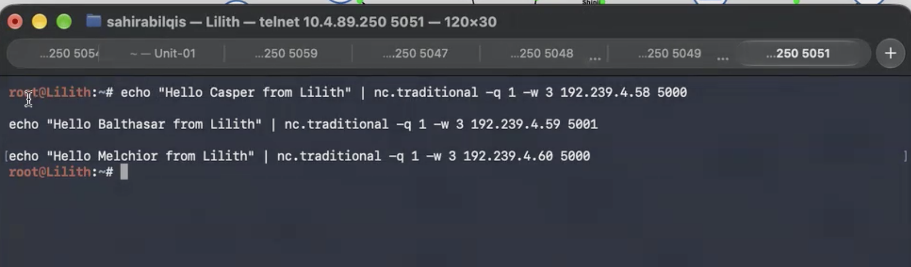

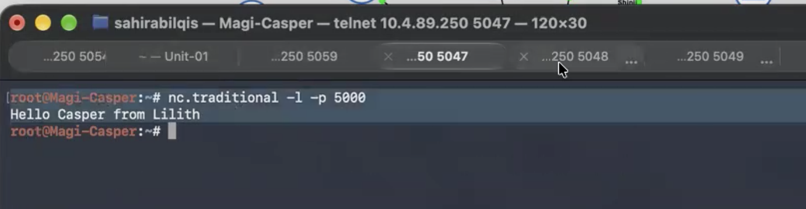

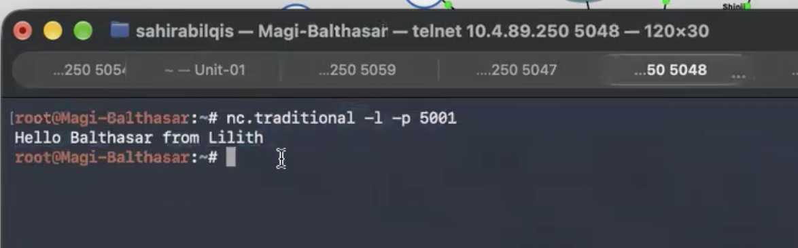

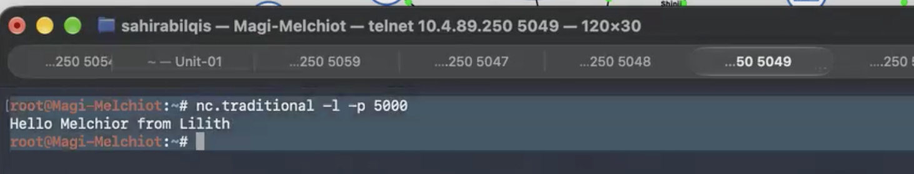

---

# SOAL 8 | Mengenali Kondisi Normal

## Konfigurasi Baseline Service

Pada soal ini dilakukan konfigurasi layanan TCP pada Pen-Pen dan Tokyo3-Core sebagai kondisi normal sebelum penerapan firewall.

Pen-Pen menjalankan layanan TCP port 80, sedangkan Tokyo3-Core menjalankan layanan TCP port 80 dan 8080.

### Rancangan Layanan

| Node | IP Address | Port | Respons |
|---|---|---|---|
| Pen-Pen | 192.239.3.195 | 80 | Welcome to Pen-Pen |
| Tokyo3-Core | 192.239.4.106 | 80 | Welcome to Tokyo3-Core |
| Tokyo3-Core | 192.239.4.106 | 8080 | syifa imutz |
| Pen-Pen | 192.239.3.195 | 22 | Connection refused |
| Tokyo3-Core | 192.239.4.106 | 22 | Connection refused |

### Konfigurasi Pen-Pen

Konfigurasi dilakukan menggunakan script `/root/no8.sh` pada Pen-Pen.

```sh
./no6.sh
./no8.sh
```

Script melakukan instalasi `netcat-traditional` dan menjalankan listener TCP port 80 secara berulang untuk memberikan respons `Welcome to Pen-Pen`.

Output listener:

```text
listening on [any] 80 ...
connect to [192.239.3.195] from (UNKNOWN) [192.239.4.74] 33270
listening on [any] 80 ...
```

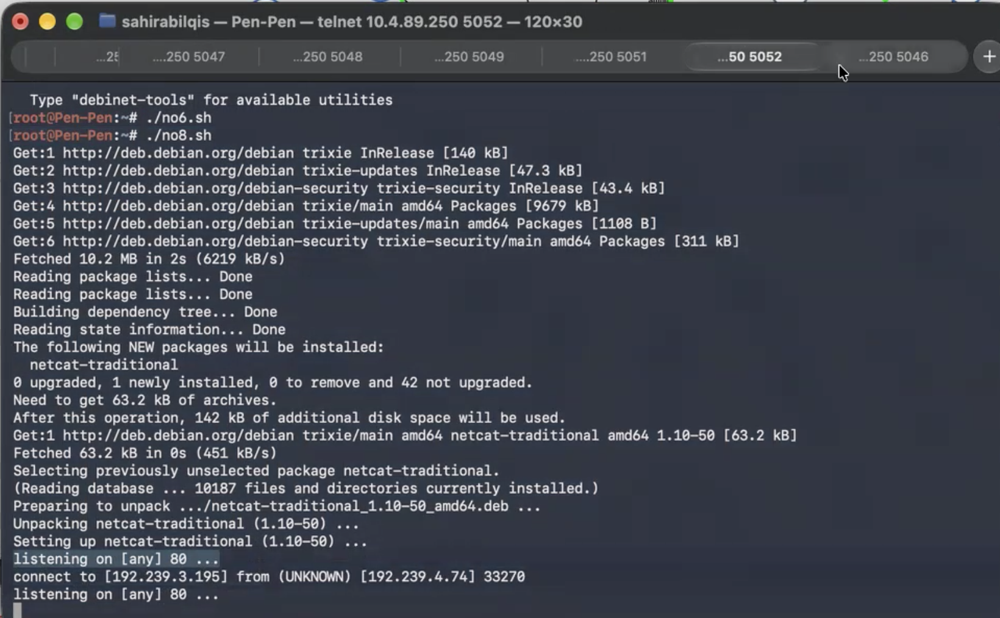

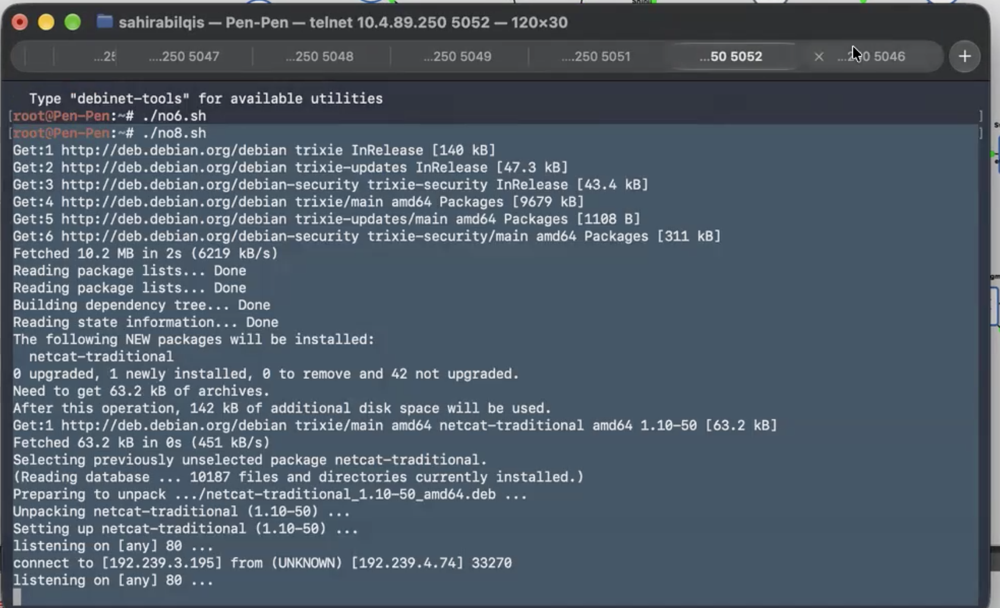

### Konfigurasi Tokyo3-Core

Pada Tokyo3-Core:

```sh
./no6.sh
./no8.sh
```

Script menjalankan dua listener TCP secara bersamaan pada port 80 dan 8080.

Port 80 memberikan respons `Welcome to Tokyo3-Core`, sedangkan port 8080 memberikan respons `syifa imutz`.

Output listener:

```text
listening on [any] 8080 ...
listening on [any] 80 ...
connect to [192.239.4.106] from (UNKNOWN) [192.239.4.74] 56838
listening on [any] 80 ...
connect to [192.239.4.106] from (UNKNOWN) [192.239.4.74] 41666
listening on [any] 8080 ...
```

### Pembuktian

Pengujian dilakukan dari Lilith menggunakan Netcat.

```sh
nc.traditional -w 3 192.239.3.195 80

nc.traditional -w 3 192.239.4.106 80

nc.traditional -w 3 192.239.4.106 8080

nc.traditional -vz -w 3 192.239.3.195 22

nc.traditional -vz -w 3 192.239.4.106 22
```

Hasil pengujian:

```text
Welcome to Pen-Pen

Welcome to Tokyo3-Core

syifa imutz

192.239.3.195: inverse host lookup failed: Host name lookup failure
(UNKNOWN) [192.239.3.195] 22 (ssh) : Connection refused

192.239.4.106: inverse host lookup failed: Host name lookup failure
(UNKNOWN) [192.239.4.106] 22 (ssh) : Connection refused
```

| Pengujian | Hasil Aktual | Status |
|---|---|---|
| Lilith - Pen-Pen port 80 | Welcome to Pen-Pen | Berhasil |
| Lilith - Tokyo3-Core port 80 | Welcome to Tokyo3-Core | Berhasil |
| Lilith - Tokyo3-Core port 8080 | syifa imutz | Berhasil |
| Lilith - Pen-Pen port 22 | Connection refused | Berhasil |
| Lilith - Tokyo3-Core port 22 | Connection refused | Berhasil |

Port 80 dan 8080 memberikan respons karena terdapat TCP listener yang aktif. Port 22 langsung memberikan `Connection refused` karena tidak terdapat layanan yang menerima koneksi atau koneksi ditolak secara aktif.

Pesan `inverse host lookup failed` tidak memengaruhi hasil pengujian karena koneksi dilakukan menggunakan alamat IP secara langsung.

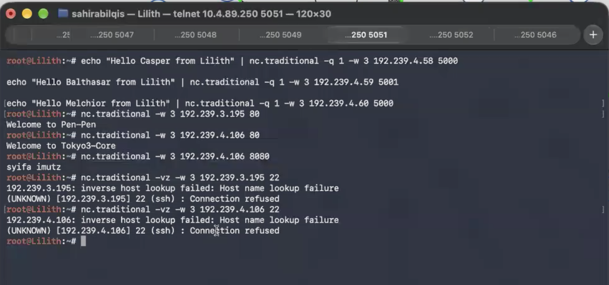

---

# SOAL 9 | Jalur Belakang Diutak-atik

## Sabotase dan Perbaikan Routing Shigeru

Pada soal ini dilakukan troubleshooting terhadap gangguan routing pada Shigeru yang menyebabkan Lilith tidak dapat berkomunikasi dengan Armisael.

### Pemetaan Node Terkait

| Node | IP Address | Keterangan |
|---|---|---|
| Lilith | 192.239.4.74/29 | Host penguji |
| Armisael | 192.239.4.83/29 | Host tujuan |
| Shigeru eth0 | 192.239.4.126/30 | Interface menuju Gendou |
| Shigeru eth1 | 192.239.4.81/29 | Gateway Switch-Monolith |
| Shigeru eth2 | 192.239.4.169/30 | Interface menuju Makoto |
| Gendou | 192.239.4.125/30 | Default next hop Shigeru |
| Makoto | 192.239.4.170/30 | Next hop Switch-Radar |

### Eksekusi Script Sabotase

Pada Shigeru:

```sh
./break_routing.sh
```

Script sabotase dijalankan tanpa membaca isi file sesuai ketentuan soal.

### Pengujian Sebelum Perbaikan

Pada Lilith:

```sh
ping -c 3 192.239.4.83
```

Pada Armisael:

```sh
ping -c 3 192.239.4.81
```

Kondisi yang diharapkan setelah sabotase:

| Pengujian | Hasil |
|---|---|
| Lilith menuju Armisael | Gagal |
| Armisael menuju gateway Shigeru | Berhasil |

Armisael tetap dapat menjangkau gateway karena keduanya berada dalam satu subnet sehingga tidak membutuhkan penerusan paket antarjaringan.

### Identifikasi Gangguan Routing

Pemeriksaan dilakukan pada Shigeru menggunakan:

```sh
ip -br a
sysctl net.ipv4.ip_forward
ip route
ip rule
ip route show table 100
```

Pemeriksaan difokuskan pada kemungkinan gangguan berikut:

| Konfigurasi | Gangguan yang Diperiksa | Dampak |
|---|---|---|
| IP forwarding | Forwarding bernilai 0 | Paket tidak diteruskan antar-interface |
| Default route | Next hop tidak mengarah ke Gendou | Paket salah diarahkan |
| Blackhole route | Rute menuju subnet Dogma dibuang | Paket tidak dapat mencapai Lilith |
| Policy routing | Unreachable route pada table 100 | Paket yang sesuai policy tidak dapat diteruskan |

Temuan aktual disesuaikan dengan hasil enumerasi Shigeru setelah script sabotase dijalankan.

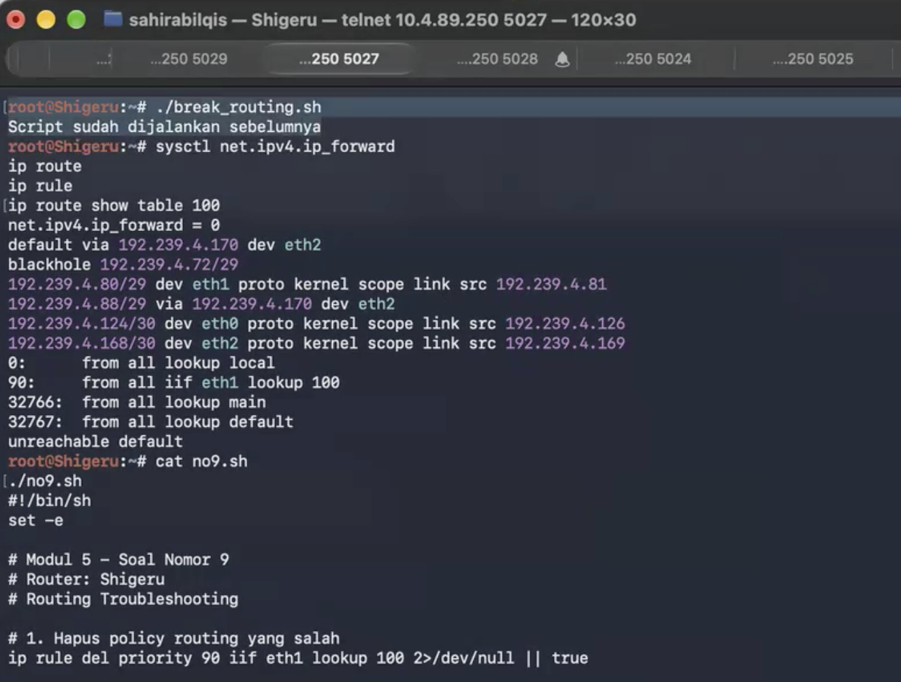

### Perbaikan Routing

Perbaikan dilakukan menggunakan script `/root/no9.sh` pada Shigeru.

```sh
cat /root/no9.sh
./no9.sh
```

Konfigurasi routing utama dikembalikan menjadi:

```sh
sysctl -w net.ipv4.ip_forward=1

ip route replace default via 192.239.4.125 dev eth0

ip route replace 192.239.4.88/29 via 192.239.4.170 dev eth2
```

Rute blackhole dan policy routing yang mengganggu komunikasi dihapus apabila ditemukan pada tahap enumerasi.

### Pembuktian Setelah Perbaikan

Pada Shigeru:

```sh
sysctl net.ipv4.ip_forward
ip route
ip rule
ip route show table 100
```

Konfigurasi normal Shigeru:

```text
net.ipv4.ip_forward = 1

default via 192.239.4.125 dev eth0
192.239.4.80/29 dev eth1
192.239.4.88/29 via 192.239.4.170 dev eth2
192.239.4.124/30 dev eth0
192.239.4.168/30 dev eth2
```

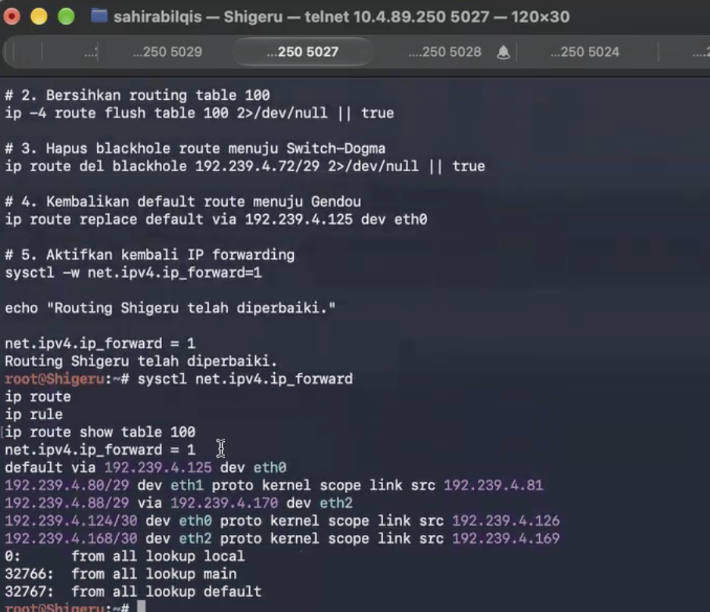

Pengujian kembali dilakukan dari Lilith:

```sh
ping -c 3 192.239.4.83
```

Hasil yang diharapkan setelah perbaikan adalah Lilith dapat kembali berkomunikasi dengan Armisael dengan `0% packet loss`.

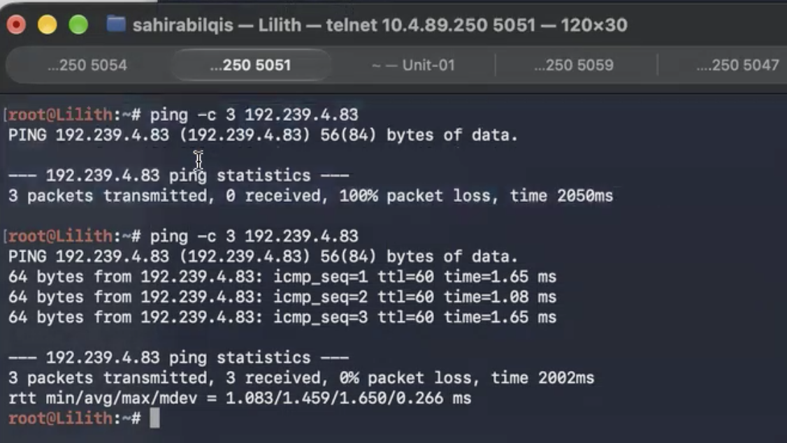

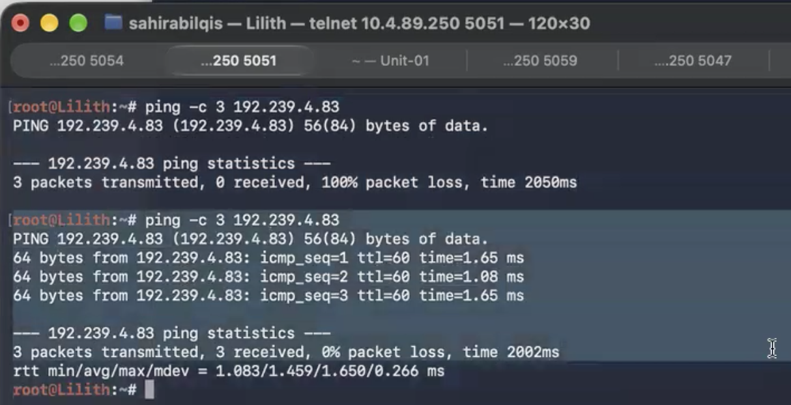

---

# SOAL 10 | Para Pilot Terkunci di Dalam

## Sabotase dan Perbaikan NAT

Pada soal ini dilakukan troubleshooting terhadap gangguan NAT pada Misato dan Gendou yang menyebabkan jaringan Cage tidak dapat mengakses internet, sedangkan jaringan Intel tetap dapat mengakses internet.

### Pemetaan Node Terkait

| Node | IP Address | Keterangan |
|---|---|---|
| Unit-01 | 192.239.4.66/29 | Host jaringan Cage |
| Misato | 192.239.4.65/29 | Gateway jaringan Cage |
| Spy | 192.239.4.102/30 | Host jaringan Intel |
| Kaji | 192.239.4.101/30 | Gateway jaringan Intel |
| Lilith | 192.239.4.74/29 | Host jaringan internal |
| Gendou | DHCP pada eth0 | Router NAT |

### Eksekusi Script Sabotase

Script `break_nat.sh` dijalankan pada kedua router yang terdampak.

Pada Misato:

```sh
./break_nat.sh
```

Pada Gendou:

```sh
./break_nat.sh
```

### Pengujian Sebelum Perbaikan

Pada Unit-01:

```sh
ping -c 3 8.8.8.8
ping -c 3 192.239.4.74
```

Pada Spy:

```sh
ping -c 3 8.8.8.8
```

Kondisi yang diharapkan setelah sabotase:

| Pengujian | Hasil |
|---|---|
| Unit-01 menuju 8.8.8.8 | Gagal |
| Unit-01 menuju Lilith | Berhasil |
| Spy menuju 8.8.8.8 | Berhasil |

Pengujian tersebut digunakan untuk membuktikan bahwa gangguan hanya memengaruhi akses internet jaringan Cage, bukan seluruh konektivitas jaringan internal.

### Identifikasi Gangguan NAT

Pemeriksaan dilakukan pada Misato dan Gendou menggunakan:

```sh
iptables -t nat -S
iptables -t nat -L POSTROUTING -n -v
```

Pemeriksaan difokuskan pada aturan SNAT, RETURN, dan MASQUERADE yang terdapat pada chain POSTROUTING.

| Router | Gangguan yang Diperiksa | Dampak |
|---|---|---|
| Misato | Rule SNAT yang tidak sesuai | Alamat sumber paket jaringan Cage berubah secara tidak semestinya |
| Gendou | Rule RETURN sebelum MASQUERADE | Trafik Cage melewati proses translasi NAT |

Aturan yang menyebabkan gangguan diidentifikasi berdasarkan output aktual tabel NAT setelah sabotase.

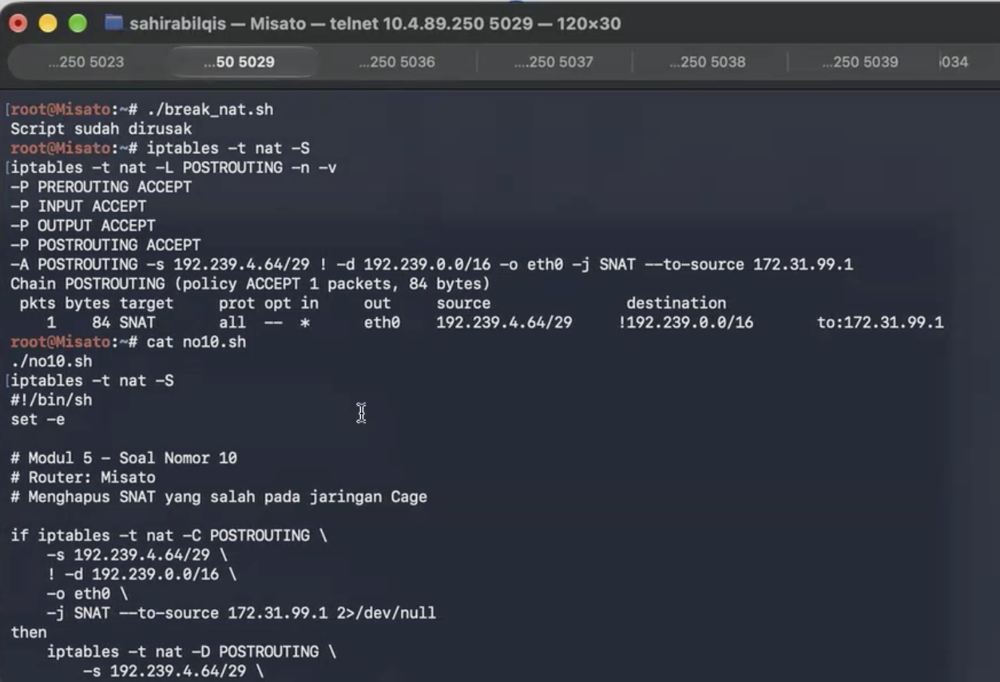

### Perbaikan NAT pada Misato

Perbaikan dilakukan menggunakan script `/root/no10.sh` pada Misato:

```sh
cat /root/no10.sh
./no10.sh
```

Script digunakan untuk menghapus aturan NAT yang tidak semestinya sehingga Misato kembali meneruskan trafik tanpa melakukan translasi alamat sumber yang tidak diperlukan.

Verifikasi:

```sh
iptables -t nat -S
```

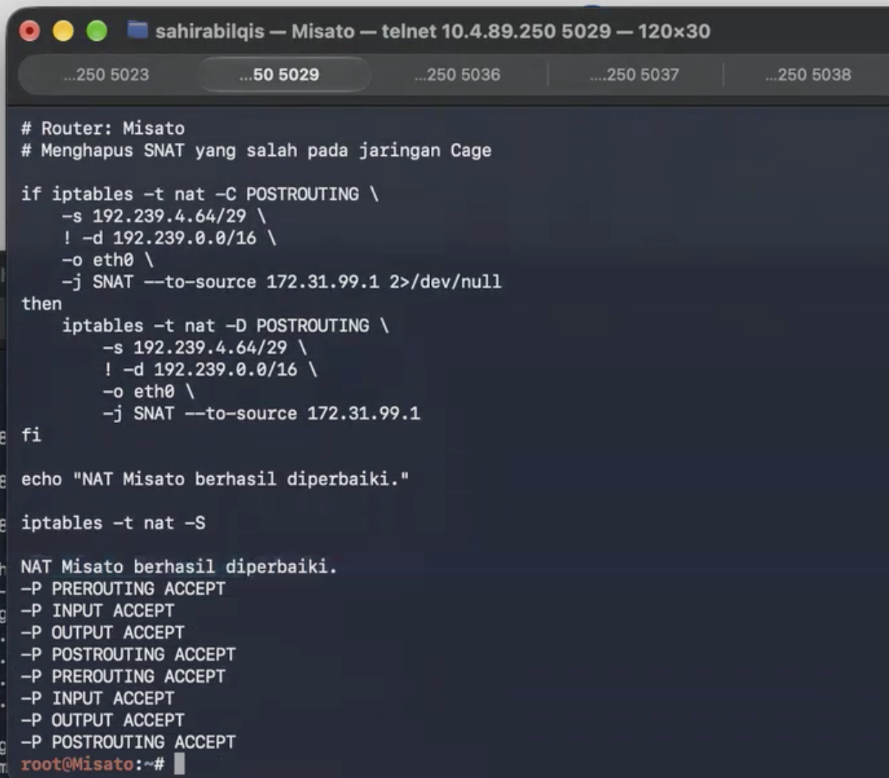

### Perbaikan NAT pada Gendou

Pada Gendou:

```sh
cat /root/no10.sh
./no10.sh
```

Konfigurasi NAT yang harus tersedia setelah perbaikan:

```sh
iptables -t nat -A POSTROUTING \
-s 192.239.0.0/21 -o eth0 -j MASQUERADE
```

Rule tersebut merupakan aturan NAT yang digunakan pada Soal 4. Aturan tidak ditambahkan ulang apabila sudah tersedia.

Verifikasi konfigurasi:

```sh
iptables -t nat -S
iptables -t nat -L POSTROUTING -n -v
```

### Pembuktian Setelah Perbaikan

Pada Unit-01:

```sh
ping -c 3 8.8.8.8
ping -c 3 192.239.4.74
```

Pada Spy:

```sh
ping -c 3 8.8.8.8
```

Pada Gendou:

```sh
iptables -t nat -L POSTROUTING -n -v
```

Hasil yang diharapkan:

| Pengujian | Hasil |
|---|---|
| Unit-01 menuju 8.8.8.8 | 0% packet loss |
| Unit-01 menuju Lilith | 0% packet loss |
| Spy menuju 8.8.8.8 | 0% packet loss |
| Counter MASQUERADE | Meningkat ketika koneksi baru diproses |

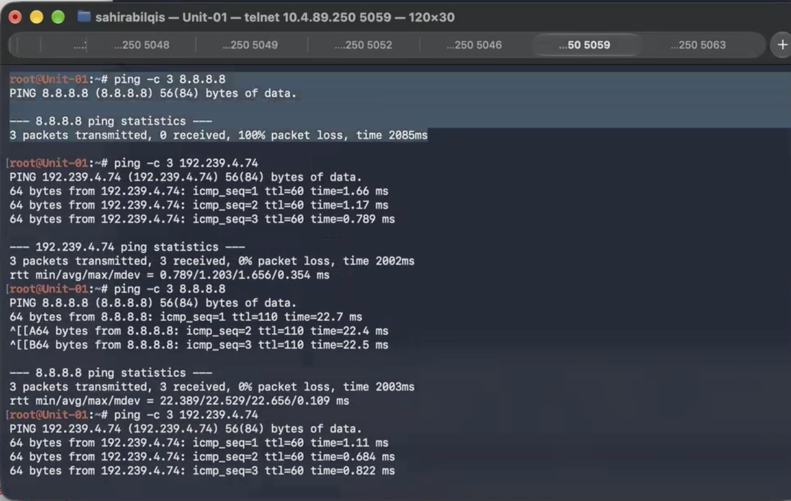

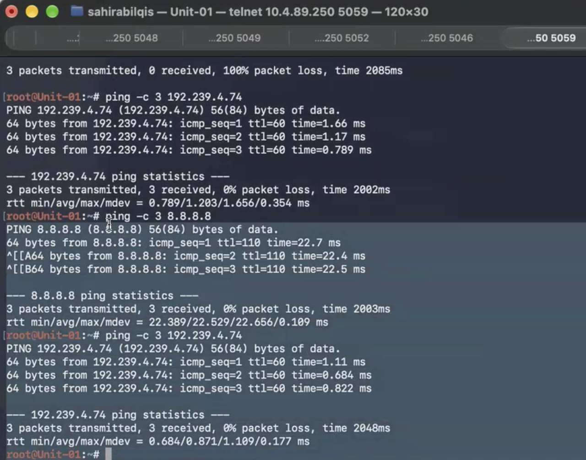

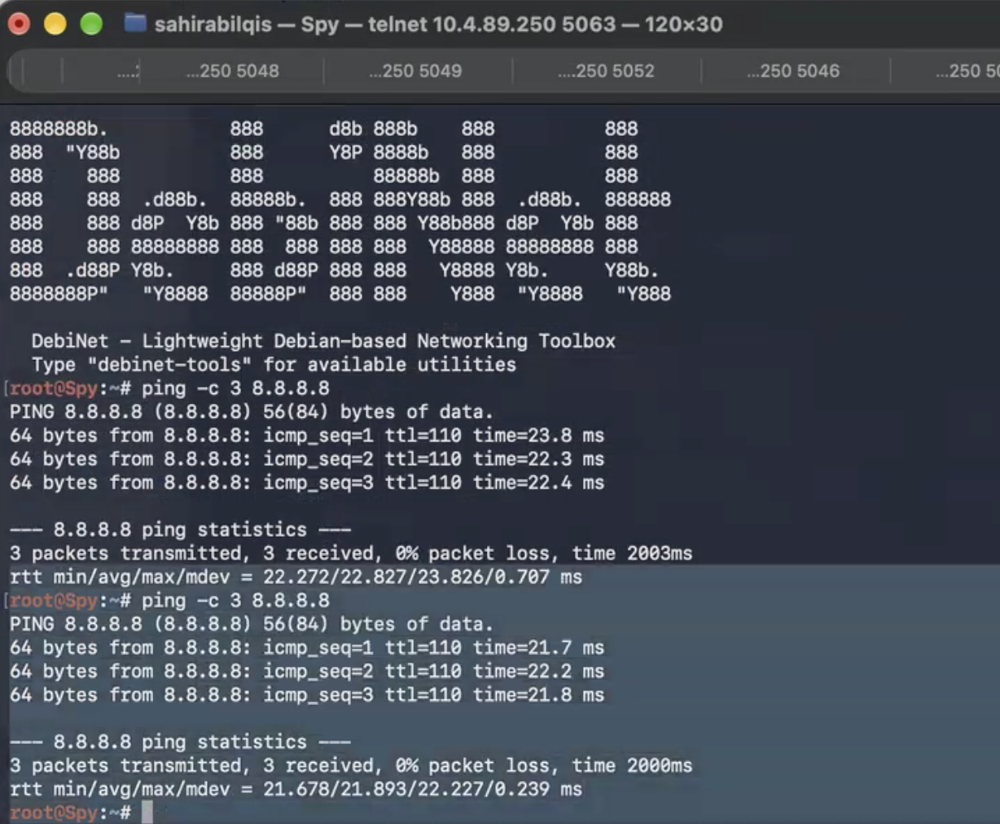

### Lokasi Translasi Alamat Sumber

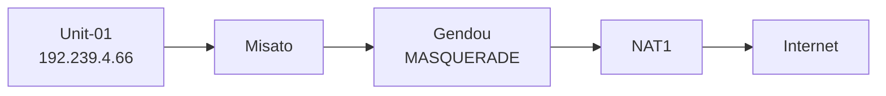

Paket dari Unit-01 diteruskan melalui Misato menuju Gendou dengan mempertahankan alamat sumber asli. Translasi alamat sumber dilakukan pada Gendou melalui chain POSTROUTING ketika paket keluar melalui interface eth0 menuju NAT1.

---

# SOAL 11 | Casper Harus Jadi Hantu

Kelompok: K56 | Prefix IP: `192.239.x.x`

> Casper harus jadi hantu: Casper adalah MAGI paling rahasia. Kalau SEELE tahu ia masih hidup, mereka tahu ke mana harus menyerang. Tidak ada perangkat lain yang boleh mem-ping Casper, termasuk yang satu switch. Casper sendiri tetap boleh mem-ping siapa saja. Layanan TCP 5000 Casper tetap hidup. Buktikan ping ke Casper dari Balthasar dan Lilith gagal, sedangkan ping dari Casper ke keduanya berhasil.

## 1. Tujuan

Menerapkan dan memverifikasi penyaringan paket (*host-based firewall*) pada chain `INPUT` di `Magi-Casper`:

* Memblokir seluruh paket `ICMP Echo Request` (`ping` masuk) yang ditujukan ke IP `Magi-Casper` (`192.239.4.58`), termasuk dari perangkat yang berada dalam satu *switch* (`Switch-Terminal`).

* Mengizinkan paket balasan dari koneksi maupun `ping` yang diinisiasi oleh `Magi-Casper` keluar melalui pencocokan state `ESTABLISHED,RELATED`.

* Menjaga layanan **TCP port `5000`** pada `Magi-Casper` tetap aktif dan dapat diakses oleh node lain.

* Membuktikan bahwa `ping` dari `Magi-Balthasar` dan `Lilith` ke `Magi-Casper` gagal, sedangkan `ping` dari `Magi-Casper` ke keduanya berhasil serta layanan TCP `5000` tetap berjalan.

## 2. Rancangan Alamat & Kebijakan Firewall

### Pemetaan Node & Layanan Terkait

| Node | Peran | Subnet | IP Address | Gateway / Layanan | 
| ----- | ----- | ----- | ----- | ----- | 
| **Magi-Casper** | Target Proteksi ("Hantu") | `192.239.4.56/29` | `192.239.4.58` | `192.239.4.57` (`Fuyutsuki`) / TCP `5000` | 
| **Magi-Balthasar** | Tetangga Satu Switch (`Switch-Terminal`) | `192.239.4.56/29` | `192.239.4.59` | `192.239.4.57` (`Fuyutsuki`) | 
| **Lilith** | Host Zona Dogma (Beda Subnet) | `192.239.4.72/29` | `192.239.4.74` | `192.239.4.73` (`Toji`) | 

### Urutan Aturan Chain `INPUT` pada `Magi-Casper`

Karena aturan diterapkan langsung pada chain `INPUT` milik `Magi-Casper`, seluruh paket yang mengarah ke `192.239.4.58`—baik dari beda subnet melalui router maupun langsung dalam satu segmen Layer-2 (`Switch-Terminal`)—akan diproses oleh aturan berikut:

| Urutan | Kondisi Pencocokan (`Match`) | Target | Keterangan | 
| ----- | ----- | ----- | ----- | 
| **1** | `-i lo` | `ACCEPT` | Mengizinkan komunikasi internal antarproses melalui interface *loopback*. | 
| **2** | `-m conntrack --ctstate ESTABLISHED,RELATED` | `ACCEPT` | Mengizinkan paket balasan (`ICMP Echo Reply` & balasan sesi TCP) dari trafik yang dimulai oleh `Magi-Casper`. | 
| **3** | `-p icmp --icmp-type echo-request` | `DROP` | Menolak secara diam-diam (*silent drop*) seluruh permintaan `ping` masuk dari perangkat mana pun. | 
| **4** | `-p tcp --dport 5000` | `ACCEPT` | Memastikan layanan pada TCP port `5000` tetap terbuka untuk koneksi masuk. | 

## 3. Konfigurasi

### 3.1 Magi-Casper – `/root/no11.sh`

Pastikan *listener* layanan TCP port `5000` pada `Magi-Casper` (dari `casper.sh`) dalam keadaan aktif, kemudian buat dan jalankan *script* `/root/no11.sh`:

```
#!/bin/sh
set -e

# Modul 5 - Soal Nomor 11
# Node: Magi-Casper (192.239.4.58)

# Pastikan paket iptables terpasang
command -v iptables >/dev/null 2>&1 || (apt-get update -qq && apt-get install -y -qq iptables)

# Reset chain INPUT agar bersih & idempoten
iptables -F INPUT
iptables -P INPUT ACCEPT

# 1. Izinkan loopback & balasan koneksi yang dimulai Casper (termasuk reply ping keluar)
iptables -A INPUT -i lo -j ACCEPT
iptables -A INPUT -m conntrack --ctstate ESTABLISHED,RELATED -j ACCEPT

# 2. Tolak semua ping masuk (ICMP echo-request), termasuk dari satu switch
iptables -A INPUT -p icmp --icmp-type echo-request -j DROP

# 3. Pastikan layanan TCP 5000 tetap terbuka
iptables -A INPUT -p tcp --dport 5000 -j ACCEPT

```

Berikan izin eksekusi dan jalankan *script* pada `Magi-Casper`:

```
chmod +x /root/no11.sh
sh /root/no11.sh

```

## 4. Pembuktian


## 5. Kesimpulan

Konfigurasi *host-based firewall* pada chain `INPUT` di `Magi-Casper` berhasil menyembunyikan keberadaan host dari pemindaian `ICMP Echo Request` (`ping`), baik dari host satu *switch* (`Magi-Balthasar`) maupun lintas subnet (`Lilith`). Di saat yang sama, `Magi-Casper` tetap dapat melakukan `ping` keluar berkat pencocokan state `ESTABLISHED,RELATED` serta tetap melayani koneksi masuk pada TCP port `5000`.

## 6. Pemulihan setelah restart

Aturan `iptables` bersifat sementara di memori dan akan hilang apabila container `Magi-Casper` mengalami *restart*. Untuk memulihkan konfigurasi *firewall*, jalankan kembali *script*:

```
sh /root/no11.sh

```

---

# SOAL 12 | Sabotase dan Pemulihan Firewall `Magi-Casper`

Kelompok: K56 | Prefix IP: `192.239.x.x`

> Terjadi sabotase pada sistem pertahanan `Magi-Casper` melalui eksekusi *script* `break_fw.sh` yang menyebabkan gangguan konektivitas keluar maupun layanan internal. Jalankan `break_fw.sh` pada `Magi-Casper`, identifikasi seluruh penyebab kerusakannya, lalu pulihkan kembali fungsi jaringan dan layanan TCP port `5000` dengan tetap mempertahankan kebijakan *hardening* (`INPUT DROP` dan pemblokiran `ping` masuk ke `Magi-Casper`). Buktikan kondisi sebelum dan sesudah perbaikan dilakukan.

## 1. Tujuan

Menganalisis dampak sabotase aturan *firewall* dan memulihkan konektivitas `Magi-Casper` tanpa menurunkan tingkat keamanannya:

* Menjalankan `break_fw.sh` pada `Magi-Casper` (`192.239.4.58`) dan mendiagnosis penyebab kegagalan akses keluar (`ping 8.8.8.8` dan `apt-get update`) serta akses layanan TCP port `5000`.
* Menghapus aturan pemblokiran DNS keluar pada chain `OUTPUT` dan mengizinkan paket balasan koneksi (`ESTABLISHED,RELATED`) pada chain `INPUT`.
* Membuka kembali akses masuk untuk layanan **TCP port `5000`** agar dapat dijangkau oleh `Unit-00` (`192.239.4.68`).
* Tetap mempertahankan kebijakan *default* `INPUT DROP` serta pemblokiran `ICMP Echo Request` (`ping` masuk) dari perangkat lain sesuai ketentuan Soal 11.

## 2. Analisis Kerusakan & Rancangan Kebijakan Firewall

### Pemetaan Node Terkait

| Node | Peran | Subnet | IP Address | Layanan / Target Uji |
|---|---|---|---|---|
| **Magi-Casper** | Node Terdampak Sabotase | `192.239.4.56/29` | `192.239.4.58` | Layanan TCP `5000` |
| **Unit-00** | Klien Pelapor | `192.239.4.64/29` | `192.239.4.68` | Mengakses TCP `5000` Casper |
| **Magi-Balthasar** | Tetangga Satu Switch | `192.239.4.56/29` | `192.239.4.59` | Uji `ping` masuk (tetap ditolak) |
| **Lilith** | Host Zona Dogma | `192.239.4.72/29` | `192.239.4.74` | Uji `ping` masuk (tetap ditolak) |
| **Seele / Repo** | Server DNS & Repository | Eksternal | `8.8.8.8` | Uji `ping` & `apt-get update` |

### Diagnosis Penyebab Kerusakan pada `break_fw.sh`

| No | Baris Penyebab pada `break_fw.sh` | Gejala yang Muncul | Penjelasan Teknis |
|---|---|---|---|
| **1** | `iptables -P INPUT DROP` tanpa aturan `ESTABLISHED,RELATED` | `Magi-Casper` gagal `ping 8.8.8.8` dan `apt-get update` gagal mengunduh paket | Trafik keluar (`OUTPUT`) diizinkan, namun paket balasan dari server luar (`ICMP Echo Reply` maupun respons TCP HTTP/HTTPS) langsung dibuang saat masuk melalui chain `INPUT`. |
| **2** | `iptables -A OUTPUT -p udp --dport 53 -j DROP` | `apt-get update` gagal menerjemahkan domain (`Temporary failure resolving 'deb.debian.org'`) | Kueri DNS keluar menuju resolver `8.8.8.8` menggunakan protokol UDP port `53` pada chain `OUTPUT` diblokir sebelum keluar dari host. |
| **3** | Penghapusan rule lama (`iptables -F INPUT`) tanpa membuka port `5000` | `Unit-00` tidak dapat terhubung ke layanan TCP port `5000` pada `Magi-Casper` | Karena *policy* `INPUT` diubah menjadi `DROP` dan aturan `ACCEPT` untuk TCP `5000` dihapus, seluruh permintaan koneksi baru ke port `5000` ditolak. |

*(Catatan: Aturan `-A INPUT -p icmp -j DROP` pada `break_fw.sh` memblokir seluruh paket ICMP masuk. Pada script perbaikan, aturan tersebut diperjelas menjadi `-p icmp --icmp-type echo-request -j DROP` agar permintaan `ping` masuk tetap ditolak, sementara balasan `ping` keluar tetap lolos melalui `ESTABLISHED,RELATED`.)*

### Rancangan Aturan Chain `INPUT` Pemulihan (`Magi-Casper`)

| Urutan | Kondisi Pencocokan (`Match`) | Target | Keterangan |
|---|---|---|---|
| **1** | `-i lo` | `ACCEPT` | Mengizinkan lalu lintas internal pada interface *loopback*. |
| **2** | `-m conntrack --ctstate ESTABLISHED,RELATED` | `ACCEPT` | Mengizinkan paket balasan dari koneksi keluar (`ping`, DNS, dan `apt-get update`). |
| **3** | `-p icmp --icmp-type echo-request` | `DROP` | Memblokir seluruh permintaan `ping` masuk ke `Magi-Casper`. |
| **4** | `-p tcp --dport 5000` | `ACCEPT` | Membuka akses layanan TCP port `5000` untuk `Unit-00` dan klien internal. |
| **Policy** | Default Policy `INPUT` | `DROP` | Menolak seluruh trafik masuk lain yang tidak diizinkan secara eksplisit. |

## 3. Konfigurasi

### 3.1 Eksekusi Script Sabotase – `/root/break_fw.sh`

Simpan dan jalankan `break_fw.sh` pada terminal `Magi-Casper` untuk mereproduksi kondisi kerusakan:

```sh
cat << 'EOF' > /root/break_fw.sh
#!/bin/sh
if [ "$FORCE" != 1 ]; then case "$(hostname)" in *[Cc]asper*) ;; *) echo "Script ini hanya untuk Magi-Casper."; exit 1;; esac; fi
[ "$(id -u)" = 0 ] || { echo "Harus root"; exit 1; }
command -v iptables >/dev/null 2>&1 || { echo "iptables belum terpasang (soal 7)."; exit 1; }
iptables -P INPUT ACCEPT
iptables -P OUTPUT ACCEPT
iptables -F INPUT
iptables -F OUTPUT
iptables -A INPUT -i lo -j ACCEPT
iptables -A INPUT -p icmp -j DROP
iptables -A OUTPUT -p udp --dport 53 -j DROP
iptables -P INPUT DROP
echo "Script sudah dirusak"
EOF

chmod +x /root/break_fw.sh
sh /root/break_fw.sh
```

### 3.2 Script Perbaikan Firewall – `/root/no12.sh`

Buat dan jalankan *script* perbaikan `/root/no12.sh` pada `Magi-Casper`:

```sh
cat << 'EOF' > /root/no12.sh
#!/bin/sh
set -e

# Modul 5 - Soal Nomor 12
# Perbaikan hardening di Magi-Casper (tetap INPUT DROP & anti-ping masuk)

# Reset chain dengan aman
iptables -P INPUT ACCEPT
iptables -P OUTPUT ACCEPT
iptables -F INPUT
iptables -F OUTPUT

# 1. Izinkan loopback
iptables -A INPUT -i lo -j ACCEPT

# 2. Izinkan paket balasan dari koneksi yang dimulai Casper (ICMP reply, DNS reply, apt-get HTTP/HTTPS)
iptables -A INPUT -m conntrack --ctstate ESTABLISHED,RELATED -j ACCEPT

# 3. Tolak ping masuk ke Casper (mempertahankan syarat Soal 11 & 12)
iptables -A INPUT -p icmp --icmp-type echo-request -j DROP

# 4. Izinkan layanan TCP 5000 Casper
iptables -A INPUT -p tcp --dport 5000 -j ACCEPT

# 5. Pertahankan default policy INPUT DROP agar lalu lintas masuk tak diizinkan tetap ditolak
iptables -P INPUT DROP
EOF

chmod +x /root/no12.sh
sh /root/no12.sh
```

## 4. Pembuktian

### 4.1 Kondisi Sebelum Perbaikan (Bukti Sabotase `break_fw.sh`)

Dijalankan setelah `sh /root/break_fw.sh` dan sebelum `sh /root/no12.sh`:

1. **Pada `Magi-Casper` (aturan rusak, `ping` keluar gagal, dan `apt-get update` gagal):**

   ```sh
   iptables -S
   ping -c 3 8.8.8.8
   apt-get update
   ```

2. **Pada `Unit-00` (koneksi ke TCP `5000` Casper gagal):**

   ```sh
   nc -vz -w 2 192.239.4.58 5000
   ```

3. **Pada `Lilith` atau `Magi-Balthasar` (`ping` ke Casper tetap ditolak):**

   ```sh
   ping -c 2 192.239.4.58
   ```

Hasil yang diamati sebelum perbaikan:

* `iptables -S` menampilkan `-P INPUT DROP` tanpa `ESTABLISHED,RELATED` dan `-A OUTPUT -p udp -m udp --dport 53 -j DROP`.
* `ping -c 3 8.8.8.8` menghasilkan `100% packet loss` dan `apt-get update` gagal melakukan resolusi DNS.
* Koneksi `nc` dari `Unit-00` ke `192.239.4.58` port `5000` mengalami *timeout* / gagal terhubung.


### 4.2 Kondisi Sesudah Perbaikan (`sh /root/no12.sh`)

Dijalankan setelah `sh /root/no12.sh` diterapkan pada `Magi-Casper`:

1. **Pada `Magi-Casper` (aturan pulih, `ping 8.8.8.8` & `apt-get update` berhasil):**

   ```sh
   iptables -S
   ping -c 3 8.8.8.8
   apt-get update
   ```

2. **Pada `Unit-00` (`192.239.4.68` — koneksi ke TCP `5000` Casper berhasil):**

   ```sh
   echo "Unit-00 lapor ke Casper" | nc -w 2 192.239.4.58 5000
   ```

3. **Pada `Lilith` atau `Magi-Balthasar` (`ping` masuk ke Casper tetap ditolak):**

   ```sh
   ping -c 2 192.239.4.58
   ```

Hasil yang diharapkan sesudah perbaikan:

* `ping -c 3 8.8.8.8` (`0% packet loss`) dan `apt-get update` pada `Magi-Casper` berjalan normal hingga selesai.
* Pesan dari `Unit-00` berhasil terkirim dan muncul pada terminal *listener* TCP `5000` di `Magi-Casper`.
* `ping -c 2 192.239.4.58` dari `Lilith` maupun `Magi-Balthasar` tetap menghasilkan `100% packet loss`.


## 5. Kesimpulan

Kerusakan konektivitas pada `Magi-Casper` akibat `break_fw.sh` disebabkan oleh pemberlakuan *policy* `INPUT DROP` tanpa aturan `ESTABLISHED,RELATED`, pemblokiran paket DNS keluar (`UDP port 53`) pada chain `OUTPUT`, serta hilangnya aturan izin untuk TCP port `5000`. Melalui penerapan `/root/no12.sh`, seluruh konektivitas keluar (`ping` dan `apt-get update`) serta layanan TCP `5000` berhasil dipulihkan, sementara kebijakan keamanan `INPUT DROP` dan anti-`ping` masuk tetap terjaga.

## 6. Pemulihan setelah restart

Aturan `iptables` bersifat sementara di memori dan akan hilang apabila container `Magi-Casper` mengalami *restart*. Untuk memulihkan konfigurasi *firewall* sekaligus *hardening* Soal 11 & 12, jalankan kembali *script*:

```sh
sh /root/no12.sh
```
---

# SOAL 13 | Brankas Balthasar

Kelompok: K56 | Prefix IP: `192.239.x.x`

> Layanan informasi sensitif pada `Magi-Balthasar` berjalan di TCP port `5000` dan `5001` serta hanya boleh diakses oleh personel resmi (`Magi-Casper` dan para Pilot EVA). Konfigurasikan aturan *firewall* pada chain `INPUT` di `Magi-Balthasar` agar hanya mengizinkan akses ke port `5000` dan `5001` dari alamat IP yang terdaftar, serta **menolak seketika** (`TCP RST`, tanpa menggantung hingga *timeout*) seluruh percobaan koneksi tidak sah lainnya—termasuk dari tetangga satu *switch* (`Magi-Melchior`). Pastikan trafik jaringan lain dan `ping` keluar ke `8.8.8.8` tetap berjalan normal.

## 1. Tujuan

Menerapkan kontrol akses berbasis daftar putih (*whitelist*) dengan penolakan aktif (*TCP Reset*) pada layanan TCP `Magi-Balthasar`:

* Memasang aturan penyaringan pada chain `INPUT` di `Magi-Balthasar` (`192.239.4.59`) agar mencakup trafik lintas subnet maupun trafik satu segmen Layer-2 (`Switch-Terminal`).
* Mengizinkan koneksi masuk ke port TCP `5000` dan `5001` khusus dari alamat IP yang berwenang (`Magi-Casper`, `Unit-01`, `Unit-02`, `Unit-00`, dan `Sachiel`).
* Menolak secara instan setiap koneksi masuk tidak sah ke port `5000` dan `5001` menggunakan target `-j REJECT --reject-with tcp-reset` sehingga klien langsung menerima respons `Connection refused`.
* Mempertahankan *default policy* `INPUT ACCEPT` serta aturan `ESTABLISHED,RELATED` agar lalu lintas lain dan balasan `ping 8.8.8.8` dari `Magi-Balthasar` tidak terganggu.

## 2. Rancangan Alamat & Kebijakan Firewall

### Pemetaan Node Terkait

| Node | Peran | Subnet | IP Address | Status Akses TCP `5000,5001` |
|---|---|---|---|---|
| **Magi-Balthasar** | Server Layanan (Brankas) | `192.239.4.56/29` | `192.239.4.59` | Host Target (Listener TCP `5000` & `5001`) |
| **Magi-Casper** | Node MAGI Otorisasi | `192.239.4.56/29` | `192.239.4.58` | **Diizinkan (`ACCEPT`)** |
| **Unit-01** | Pilot EVA | `192.239.4.64/29` | `192.239.4.66` | **Diizinkan (`ACCEPT`)** |
| **Unit-02** | Pilot EVA | `192.239.4.64/29` | `192.239.4.67` | **Diizinkan (`ACCEPT`)** |
| **Unit-00** | Pilot EVA | `192.239.4.64/29` | `192.239.4.68` | **Diizinkan (`ACCEPT`)** |
| **Sachiel** | Node Otorisasi Cabang | `192.239.3.128/26` | `192.239.3.130` | **Diizinkan (`ACCEPT`)** |
| **Magi-Melchior** | Tetangga Satu Switch | `192.239.4.56/29` | `192.239.4.60` | **Ditolak Seketika (`REJECT tcp-reset`)** |
| **Lilith** | Host Zona Dogma | `192.239.4.72/29` | `192.239.4.74` | **Ditolak Seketika (`REJECT tcp-reset`)** |

### Urutan Aturan Chain `INPUT` pada `Magi-Balthasar`

| Urutan | Kondisi Pencocokan (`Match`) | Target | Keterangan |
|---|---|---|---|
| **1** | `-i lo` | `ACCEPT` | Mengizinkan komunikasi internal antarproses pada interface *loopback*. |
| **2** | `-m conntrack --ctstate ESTABLISHED,RELATED` | `ACCEPT` | Mengizinkan paket balasan dari sesi keluar yang dimulai oleh `Magi-Balthasar`. |
| **3–7** | `-p tcp -s <IP_RESMI> -m multiport --dports 5000,5001` | `ACCEPT` | Mengizinkan koneksi TCP ke port `5000` dan `5001` dari `192.239.4.58`, `.4.66`, `.4.67`, `.4.68`, dan `.3.130`. |
| **8** | `-p tcp -m multiport --dports 5000,5001` | `REJECT --reject-with tcp-reset` | Mengirim paket `TCP RST` seketika untuk menolak koneksi tidak sah ke port `5000` dan `5001`. |
| **Policy** | Default Policy `INPUT` | `ACCEPT` | Membiarkan lalu lintas jaringan lain (seperti `ping` dan layanan di luar port tersebut) berjalan normal. |

## 3. Konfigurasi

### 3.1 Magi-Balthasar – `/root/no13.sh`

Pastikan layanan *listener* TCP port `5000` dan `5001` pada `Magi-Balthasar` (dari `balthasar.sh`) sedang berjalan, kemudian buat dan jalankan *script* `/root/no13.sh`:

```sh
cat << 'EOF' > /root/no13.sh
#!/bin/sh
set -e

# Modul 5 - Soal Nomor 13
# Node: Magi-Balthasar (192.239.4.59)

# Reset chain INPUT agar bersih & idempoten
iptables -F INPUT
iptables -P INPUT ACCEPT

# Izinkan loopback & koneksi yang sudah terbentuk
iptables -A INPUT -i lo -j ACCEPT
iptables -A INPUT -m conntrack --ctstate ESTABLISHED,RELATED -j ACCEPT

# Daftar IP yang diizinkan ke TCP 5000 & 5001:
# - Magi-Casper: 192.239.4.58
# - Pilot: Unit-01 (.4.66), Unit-02 (.4.67), Unit-00 (.4.68), Sachiel (.3.130)
for SRC in 192.239.4.58 192.239.4.66 192.239.4.67 192.239.4.68 192.239.3.130; do
    iptables -A INPUT -p tcp -s "$SRC" -m multiport --dports 5000,5001 -j ACCEPT
done

# Tolak seketika (TCP RST) semua koneksi lain ke port 5000 & 5001
iptables -A INPUT -p tcp -m multiport --dports 5000,5001 -j REJECT --reject-with tcp-reset
EOF

chmod +x /root/no13.sh
sh /root/no13.sh
```

## 4. Pembuktian

### 4.1 Magi-Balthasar (Aturan Firewall & Ping Keluar)

Dijalankan pada terminal `Magi-Balthasar`:

```sh
iptables -S
iptables -L INPUT -n -v
ping -c 3 8.8.8.8
```

Hasil yang diharapkan:

* `iptables -S` menampilkan kelima aturan `ACCEPT` untuk IP sumber berwenang yang diikuti oleh aturan `-A INPUT -p tcp -m multiport --dports 5000,5001 -j REJECT --reject-with tcp-reset`.
* `ping -c 3 8.8.8.8` dari `Magi-Balthasar` berhasil (`0% packet loss`).

### 4.2 Pengujian Akses Resmi & Penolakan Seketika (`Unit-01`, `Lilith`, & `Magi-Melchior`)

1. **Dari `Unit-01` (`192.239.4.66` — IP Diizinkan):**

   ```sh
   echo "Unit-01 akses 5000" | nc -w 2 192.239.4.59 5000
   echo "Unit-01 akses 5001" | nc -w 2 192.239.4.59 5001
   ```

2. **Dari `Lilith` (`192.239.4.74` — Beda Subnet, Tidak Diizinkan):**

   ```sh
   nc -vz 192.239.4.59 5000
   nc -vz 192.239.4.59 5001
   ```

   *(Apabila menggunakan `nc` versi BusyBox tanpa opsi `-v`, jalankan `echo "tes" | nc 192.239.4.59 5000; echo $?` yang langsung selesai dalam $< 1$ detik dengan exit code `1`.)*

3. **Dari `Magi-Melchior` (`192.239.4.60` — Tetangga Satu Switch, Tidak Diizinkan):**

   ```sh
   nc -vz 192.239.4.59 5000
   nc -vz 192.239.4.59 5001
   ```

Hasil yang diharapkan:

* Pengiriman pesan dari `Unit-01` ke port `5000` dan `5001` **berhasil** serta pesan `Unit-01 akses 5000` dan `Unit-01 akses 5001` tercatat pada *listener* / log di `Magi-Balthasar`.
* Percobaan koneksi dari `Lilith` maupun `Magi-Melchior` ke port `5000` dan `5001` **langsung ditolak seketika** (`Connection refused` / exit code `1` dalam waktu $< 1$ detik tanpa menunggu *timeout*).


## 5. Kesimpulan

Konfigurasi *firewall* pada chain `INPUT` di `Magi-Balthasar` berhasil membatasi akses layanan TCP port `5000` dan `5001` secara selektif hanya untuk `Magi-Casper` dan keempat Pilot EVA. Penggunaan target `REJECT --reject-with tcp-reset` memastikan seluruh percobaan akses tidak sah—baik lintas subnet (`Lilith`) maupun dari tetangga satu *switch* (`Magi-Melchior`)—langsung diputus seketika dengan respons `TCP RST` (`Connection refused`), sementara lalu lintas normal dan `ping` keluar tetap berjalan lancar.

## 6. Pemulihan setelah restart

Aturan `iptables` bersifat sementara di memori dan akan terhapus apabila container `Magi-Balthasar` mengalami *restart*. Untuk memulihkan aturan pembatasan akses tersebut, jalankan kembali *script*:

```sh
sh /root/no13.sh
```
---

# SOAL 14 | Jam Kunjungan `Pen-Pen`

Kelompok: K56 | Prefix IP: `192.239.x.x`

> Akses menuju `Pen-Pen` (`192.239.3.194`) untuk layanan HTTP (TCP port `80`) dan pengecekan `ping` (`ICMP Echo Request`) harus dibatasi berdasarkan peran serta jam operasional. Konfigurasikan aturan *firewall* berbasis waktu (`-m time`) pada `Pen-Pen` dengan ketentuan: kelompok **Pilot** hanya diizinkan pada pukul `08.00 – 16.00 WIB` (Senin–Jumat), **Staf Geofront** pada pukul `17.00 – 23.00 WIB` (setiap hari), kelompok **Terduga Dummy System** selalu ditolak sepanjang waktu, dan kelompok lainnya bebas mengakses tanpa batasan waktu. Buktikan perilaku akses pada kondisi jadwal aktif maupun di luar jadwal.

## 1. Tujuan

Menerapkan pengendalian akses berbasis waktu (*time-based firewall*) menggunakan modul `time` pada `iptables` di `Pen-Pen`:

- Mengarahkan trafik masuk `ICMP Echo Request` (`ping`) dan `TCP port 80` pada `Pen-Pen` (`192.239.3.194`) ke *custom chain* `PENPEN_ACL`.
- Mengonversi seluruh jadwal operasional dari zona waktu **WIB (UTC+7)** ke zona waktu sistem standar `iptables` yaitu **UTC** ($\text{UTC} = \text{WIB} - 7\text{ jam}$).
- Memblokir secara permanen (`DROP`) seluruh trafik `ping` dan HTTP dari kelompok **Terduga Dummy System** (`Entry-Plug`, `Dummy-Plug`, dan `Spy`).
- Membatasi akses **Pilot** (`Unit-01`, `Unit-02`, `Unit-00`, `Sachiel`) hanya pada `01:00 – 09:00 UTC` hari Senin–Jumat, serta **Staf Geofront** (`Lilith`, `Adam`) hanya pada `10:00 – 16:00 UTC` setiap hari.
- Membuktikan bahwa permintaan dari Pilot dan Staf berhasil saat berada di dalam rentang jadwal dan ditolak saat di luar rentang jadwal, sementara Terduga Dummy System selalu ditolak.

## 2. Rancangan Alamat & Kebijakan Jadwal Firewall

### Pemetaan Kelompok Node & Konversi Jadwal (WIB ke UTC)

| Kelompok Peran | Daftar Node & IP Address | Jadwal Akses (WIB) | Jadwal Konversi (`iptables` UTC) | Kebijakan di Luar Jadwal |
|---|---|---|---|---|
| **Terduga Dummy System** | `Entry-Plug` (`192.239.4.50`)<br>`Dummy-Plug` (`192.239.4.51`)<br>`Spy` (`192.239.4.102`) | Tidak ada (Diblokir penuh) | Selalu `DROP` | `DROP` |
| **Pilot** | `Unit-01` (`192.239.4.66`)<br>`Unit-02` (`192.239.4.67`)<br>`Unit-00` (`192.239.4.68`)<br>`Sachiel` (`192.239.3.130`) | `08.00 – 16.00 WIB`<br>(Senin – Jumat) | `01:00 – 09:00 UTC`<br>(`Mon,Tue,Wed,Thu,Fri`) | `DROP` |
| **Staf Geofront** | `Lilith` (`192.239.4.74`)<br>`Adam` (`192.239.4.75`) | `17.00 – 23.00 WIB`<br>(Setiap hari) | `10:00 – 16:00 UTC`<br>(Setiap hari) | `DROP` |
| **Lainnya** | Seluruh IP di luar daftar di atas | Tanpa batasan waktu | Tanpa batasan waktu | `RETURN` $\rightarrow$ `ACCEPT` |

### Alur Evaluasi Chain `INPUT` & `PENPEN_ACL` pada `Pen-Pen`

1. Pada chain `INPUT`, trafik *loopback* (`-i lo`) dan paket balasan koneksi (`ESTABLISHED,RELATED`) diizinkan terlebih dahulu.
2. Paket `ICMP Echo Request` (`-p icmp --icmp-type echo-request`) dan paket `TCP port 80` (`-p tcp --dport 80`) dilompatkan (`-j PENPEN_ACL`) untuk diperiksa terhadap daftar IP dan jadwal waktu.
3. Jika IP sumber tidak termasuk dalam daftar *Dummy System*, *Pilot*, maupun *Staf Geofront*, aturan terakhir pada `PENPEN_ACL` (`-j RETURN`) mengembalikan paket ke chain `INPUT` dengan kebijakan *default* `ACCEPT`.

## 3. Konfigurasi

### 3.1 Pen-Pen – `/root/no14.sh`

Pastikan layanan HTTP pada TCP port `80` di `Pen-Pen` (dari konfigurasi sebelumnya) tetap aktif, lalu buat dan jalankan *script* `/root/no14.sh`:

```sh
cat << 'EOF' > /root/no14.sh
#!/bin/sh
set -e

# Modul 5 - Soal Nomor 14
# Node: Pen-Pen (192.239.3.194)

# Jadwal dalam UTC (WIB - 7 jam)
PILOT_START="01:00"
PILOT_STOP="09:00"
PILOT_DAYS="Mon,Tue,Wed,Thu,Fri"
STAF_START="10:00"
STAF_STOP="16:00"

# Reset chain INPUT & custom chain PENPEN_ACL
iptables -F INPUT
iptables -P INPUT ACCEPT
iptables -F PENPEN_ACL 2>/dev/null || iptables -N PENPEN_ACL

# Izinkan loopback & koneksi yang sudah terbentuk
iptables -A INPUT -i lo -j ACCEPT
iptables -A INPUT -m conntrack --ctstate ESTABLISHED,RELATED -j ACCEPT

# Arahkan trafik ping & TCP 80 ke chain PENPEN_ACL
iptables -A INPUT -p icmp --icmp-type echo-request -j PENPEN_ACL
iptables -A INPUT -p tcp --dport 80 -j PENPEN_ACL

# 1. Terduga Dummy System: Entry-Plug (.4.50), Dummy-Plug (.4.51), Spy (.4.102) -> Selalu ditolak
for IP in 192.239.4.50 192.239.4.51 192.239.4.102; do
    iptables -A PENPEN_ACL -s "$IP" -j DROP
done

# 2. Pilot: Unit-01 (.4.66), Unit-02 (.4.67), Unit-00 (.4.68), Sachiel (.3.130)
for IP in 192.239.4.66 192.239.4.67 192.239.4.68 192.239.3.130; do
    iptables -A PENPEN_ACL -s "$IP" -m time --timestart "$PILOT_START" --timestop "$PILOT_STOP" --weekdays "$PILOT_DAYS" -j ACCEPT
    iptables -A PENPEN_ACL -s "$IP" -j DROP
done

# 3. Staf Geofront: Lilith (.4.74), Adam (.4.75)
for IP in 192.239.4.74 192.239.4.75; do
    iptables -A PENPEN_ACL -s "$IP" -m time --timestart "$STAF_START" --timestop "$STAF_STOP" -j ACCEPT
    iptables -A PENPEN_ACL -s "$IP" -j DROP
done

# 4. Lainnya -> RETURN ke INPUT (ACCEPT)
iptables -A PENPEN_ACL -j RETURN
EOF

chmod +x /root/no14.sh
sh /root/no14.sh
```

## 4. Pembuktian

Pengujian dilakukan dalam dua skenario waktu dengan menyesuaikan sementara parameter variabel jadwal pada `/root/no14.sh` terhadap waktu UTC sistem (`date -u`) tanpa mengubah jam sistem host.

### 4.1 Kondisi A — Jadwal Cocok dengan Jam Sekarang (Pilot & Staf Diizinkan)

1. **Pada `Pen-Pen`** — periksa jam UTC saat ini (`date -u`), sesuaikan sementara rentang jam uji (misalnya `07:00 – 08:00 UTC` hari `Thu`) menggunakan `sed`, lalu jalankan ulang `/root/no14.sh`:

   ```sh
   date -u
   sed -i 's/PILOT_START=.*/PILOT_START="07:00"/' /root/no14.sh
   sed -i 's/PILOT_STOP=.*/PILOT_STOP="08:00"/' /root/no14.sh
   sed -i 's/PILOT_DAYS=.*/PILOT_DAYS="Thu"/' /root/no14.sh
   sed -i 's/STAF_START=.*/STAF_START="07:00"/' /root/no14.sh
   sed -i 's/STAF_STOP=.*/STAF_STOP="08:00"/' /root/no14.sh
   sh /root/no14.sh
   head -n 12 /root/no14.sh
   ```

2. **Uji `ping` ke `Pen-Pen` (`192.239.3.194`) dari ketiga kelompok node:**

   - **Dari `Unit-01` (`192.239.4.66` — Pilot):**
     ```sh
     ping -c 2 192.239.3.194
     ```
   - **Dari `Lilith` (`192.239.4.74` — Staf Geofront):**
     ```sh
     ping -c 2 192.239.3.194
     ```
   - **Dari `Spy` (`192.239.4.102` — Terduga Dummy System):**
     ```sh
     ping -c 2 192.239.3.194
     ```

Hasil yang diharapkan pada Kondisi A:

- `ping` dari `Unit-01` (Pilot) dan `Lilith` (Staf Geofront) ke `192.239.3.194` **berhasil** (`0% packet loss`).
- `ping` dari `Spy` (Terduga Dummy System) ke `192.239.3.194` **gagal** (`100% packet loss`).

Screenshot:


### 4.2 Kondisi B — Jadwal Tidak Cocok dengan Jam Sekarang (Pilot & Staf Ditolak)

1. **Pada `Pen-Pen`** — geser sementara variabel jadwal ke luar jam saat ini (misalnya `20:00 – 21:00 UTC`), lalu jalankan ulang `/root/no14.sh`:

   ```sh
   sed -i 's/PILOT_START=.*/PILOT_START="20:00"/' /root/no14.sh
   sed -i 's/PILOT_STOP=.*/PILOT_STOP="21:00"/' /root/no14.sh
   sed -i 's/STAF_START=.*/STAF_START="20:00"/' /root/no14.sh
   sed -i 's/STAF_STOP=.*/STAF_STOP="21:00"/' /root/no14.sh
   sh /root/no14.sh
   head -n 12 /root/no14.sh
   ```

2. **Uji ulang `ping` ke `Pen-Pen` (`192.239.3.194`) dari ketiga kelompok node:**

   - **Dari `Unit-01` (`192.239.4.66`):** `ping -c 2 192.239.3.194`
   - **Dari `Lilith` (`192.239.4.74`):** `ping -c 2 192.239.3.194`
   - **Dari `Spy` (`192.239.4.102`):** `ping -c 2 192.239.3.194`

Hasil yang diharapkan pada Kondisi B:

- Seluruh pengujian `ping` dari `Unit-01`, `Lilith`, maupun `Spy` ke `192.239.3.194` **gagal** (`100% packet loss`).

Screenshot:


### 4.3 Pengembalian Variabel Jadwal ke Ketentuan Soal Asli

Setelah kedua kondisi pengujian selesai didokumentasikan, variabel jadwal pada `/root/no14.sh` dikembalikan ke nilai ketentuan soal (`01:00–09:00 UTC` Senin–Jumat untuk Pilot dan `10:00–16:00 UTC` setiap hari untuk Staf Geofront) dan diterapkan ulang:

```sh
sed -i 's/PILOT_START=.*/PILOT_START="01:00"/' /root/no14.sh
sed -i 's/PILOT_STOP=.*/PILOT_STOP="09:00"/' /root/no14.sh
sed -i 's/PILOT_DAYS=.*/PILOT_DAYS="Mon,Tue,Wed,Thu,Fri"/' /root/no14.sh
sed -i 's/STAF_START=.*/STAF_START="10:00"/' /root/no14.sh
sed -i 's/STAF_STOP=.*/STAF_STOP="16:00"/' /root/no14.sh
sh /root/no14.sh
iptables -S PENPEN_ACL
```

Screenshot:


## 5. Kesimpulan

Penerapan *custom chain* `PENPEN_ACL` yang dipadukan dengan modul `-m time` pada `Pen-Pen` (`192.239.3.194`) berhasil membatasi akses layanan `ICMP Echo Request` (`ping`) dan `TCP port 80` sesuai peran serta jadwal operasional masing-masing kelompok. Konversi jadwal WIB ke UTC (`WIB - 7 jam`) memastikan evaluasi waktu oleh `iptables` berjalan akurat: kelompok *Dummy System* selalu ditolak, sedangkan *Pilot* dan *Staf Geofront* hanya dapat mengakses pada jam yang telah ditentukan.

## 6. Pemulihan setelah restart

Aturan `iptables` bersifat sementara di memori dan akan hilang apabila container `Pen-Pen` mengalami *restart*. Untuk memulihkan kebijakan pembatasan waktu sesuai jadwal soal, jalankan kembali *script*:

```sh
sh /root/no14.sh
```
---

# SOAL 15 | Banjir Ping di `Tokyo3-Core`

Kelompok: K56 | Prefix IP: `192.239.x.x`

> `Tokyo3-Core` (`192.239.4.106`) menjadi sasaran serangan banjir paket `ICMP Echo Request` (*ping flood*) yang berpotensi membebani sumber daya sistem. Konfigurasikan pembatasan laju (*rate limiting*) pada chain `INPUT` di `Tokyo3-Core` menggunakan modul `-m limit` agar hanya menerima maksimal **5 permintaan `ping` per detik** dan membuang (`DROP`) seluruh paket `ping` masuk yang melebihi batas tersebut. Pastikan `ping` yang dikirim keluar oleh `Tokyo3-Core` sendiri tetap berjalan bebas tanpa pembatasan, serta buktikan kenaikan *counter* pembuangan paket pada `iptables`.

## 1. Tujuan

Menerapkan dan memverifikasi mitigasi *ICMP flood* menggunakan modul `limit` pada `iptables` di `Tokyo3-Core`:

- Membatasi paket masuk `ICMP Echo Request` (`--icmp-type echo-request`) pada `Tokyo3-Core` (`192.239.4.106`) maksimal sebanyak $5\text{ paket/detik}$ (`--limit 5/second --limit-burst 5`).
- Membuang (`DROP`) seluruh paket `ping` masuk yang melampaui ambang batas $5\text{ paket/detik}$.
- Memastikan lalu lintas `ping` keluar yang diinisiasi oleh `Tokyo3-Core` tidak ikut terbatasi karena paket balasannya (`ICMP Echo Reply`) diizinkan melalui pencocokan state `ESTABLISHED,RELATED`.
- Membuktikan kenaikan jumlah paket pada kolom `pkts` aturan `DROP` saat menerima banjir *ping* rapat (`interval 0,1 detik`), keberhasilan penuh (`0% packet loss`) pada *ping* berjeda normal (`interval 3 detik`), serta kelancaran *ping* keluar dari `Tokyo3-Core`.

## 2. Rancangan Alamat & Kebijakan Firewall

### Pemetaan Node Terkait

| Node | Peran | Subnet | IP Address | Layanan / Target Uji |
|---|---|---|---|---|
| **Tokyo3-Core** | Host Target Proteksi (*Rate Limit*) | `192.239.4.104/29` | `192.239.4.106` | Listener TCP `80` & `8080` |
| **Lilith** | Host Penguji (Pengirim Ping) | `192.239.4.72/29` | `192.239.4.74` | Pengirim banjir *ping* & *ping* normal |

### Urutan Aturan Chain `INPUT` pada `Tokyo3-Core`

| Urutan | Kondisi Pencocokan (`Match`) | Target | Keterangan |
|---|---|---|---|
| **1** | `-i lo` | `ACCEPT` | Mengizinkan komunikasi internal pada interface *loopback*. |
| **2** | `-m conntrack --ctstate ESTABLISHED,RELATED` | `ACCEPT` | Mengizinkan paket balasan (`ICMP Echo Reply` & sesi TCP aktif) dari koneksi yang dimulai `Tokyo3-Core`. |
| **3** | `-p icmp --icmp-type echo-request -m limit --limit 5/second --limit-burst 5` | `ACCEPT` | Mengizinkan permintaan `ping` masuk hingga kapasitas maksimum $5\text{ paket/detik}$. |
| **4** | `-p icmp --icmp-type echo-request` | `DROP` | Membuang seluruh paket `ping` masuk berlebih yang tidak tertampung oleh aturan *rate limit* di atasnya. |

## 3. Konfigurasi

### 3.1 Tokyo3-Core – `/root/no15.sh`

Pastikan layanan *listener* port `80` dan `8080` pada `Tokyo3-Core` (dari konfigurasi sebelumnya) tetap berjalan, kemudian buat dan jalankan *script* `/root/no15.sh`:

```sh
cat << 'EOF' > /root/no15.sh
#!/bin/sh
set -e

# Modul 5 - Soal Nomor 15
# Node: Tokyo3-Core (192.239.4.106)

# Reset chain INPUT agar bersih & counter mulai dari 0
iptables -F INPUT
iptables -P INPUT ACCEPT

# 1. Izinkan loopback & paket balasan (termasuk echo-reply untuk ping keluar Tokyo3-Core)
iptables -A INPUT -i lo -j ACCEPT
iptables -A INPUT -m conntrack --ctstate ESTABLISHED,RELATED -j ACCEPT

# 2. Batasi ping masuk (echo-request) maksimal 5 per detik, buang kelebihannya
iptables -A INPUT -p icmp --icmp-type echo-request -m limit --limit 5/second --limit-burst 5 -j ACCEPT
iptables -A INPUT -p icmp --icmp-type echo-request -j DROP
EOF

chmod +x /root/no15.sh
sh /root/no15.sh
```

## 4. Pembuktian

### 4.1 Counter Awal `iptables` di `Tokyo3-Core` (Sebelum Banjir Ping)

Jalankan perintah berikut pada terminal `Tokyo3-Core` tepat setelah menjalankan `no15.sh`:

```sh
iptables -L INPUT -v -n
```

Hasil yang diharapkan:

- Kolom `pkts` pada baris aturan `DROP icmp -- * * 0.0.0.0/0 0.0.0.0/0 icmptype 8` masih bernilai **`0`**.


### 4.2 Pengujian Banjir Ping dari `Lilith` & Kenaikan Counter Pembuangan

1. **Dari `Lilith` (`192.239.4.74`)** — kirimkan $50$ paket `ping` rapat dengan jeda $0,1\text{ detik}$ ($10\text{ paket/detik}$) ke `Tokyo3-Core`:

   ```sh
   ping -i 0.1 -c 50 192.239.4.106
   ```

2. **Pada `Tokyo3-Core` (`192.239.4.106`)** — periksa kembali statistik paket pada chain `INPUT`:

   ```sh
   iptables -L INPUT -v -n
   ```

Hasil yang diharapkan:

- Pada terminal `Lilith`, sebagian paket tidak mendapat balasan (terjadi *packet loss* sekitar $30\%\text{–}50\%$) karena laju pengiriman ($10\text{ paket/detik}$) melampaui batas maksimal $5\text{ paket/detik}$.
- Pada terminal `Tokyo3-Core`, kolom `pkts` pada baris `DROP icmp ... icmptype 8` meningkat sesuai jumlah paket `ping` berlebih yang dibuang oleh *firewall*.

### 4.3 Pengujian Ping Normal & Ping Keluar dari `Tokyo3-Core`

1. **Dari `Lilith` (`192.239.4.74`)** — uji `ping` biasa dengan jeda $3\text{ detik}$ antar paket (di bawah batas $5\text{ paket/detik}$):

   ```sh
   ping -i 3 -c 5 192.239.4.106
   ```

2. **Dari `Tokyo3-Core` (`192.239.4.106`)** — uji `ping` rapat keluar menuju `Lilith` ($15$ paket dengan jeda $0,1\text{ detik}$):

   ```sh
   ping -i 0.1 -c 15 192.239.4.74
   ```

Hasil yang diharapkan:

- `ping -i 3 -c 5 192.239.4.106` dari `Lilith` berhasil sepenuhnya (**`0% packet loss`**).
- `ping -i 0.1 -c 15 192.239.4.74` dari `Tokyo3-Core` berhasil sepenuhnya (**`0% packet loss`**), membuktikan pembatasan hanya berlaku untuk trafik masuk dan tidak mengganggu trafik keluar.

Screenshot:


## 5. Kesimpulan

Penerapan modul `-m limit` (`--limit 5/second --limit-burst 5`) pada chain `INPUT` di `Tokyo3-Core` berhasil meredam serangan banjir `ICMP Echo Request` tanpa memutus komunikasi normal. Paket `ping` masuk yang dikirim dengan laju tinggi ($0,1\text{ detik/paket}$) otomatis dipangkas oleh aturan `DROP` (terbukti dari kenaikan nilai `pkts`), sementara `ping` dengan jeda normal maupun `ping` keluar yang diinisiasi oleh `Tokyo3-Core` tetap berjalan lancar dengan `0% packet loss`.

## 6. Pemulihan setelah restart

Aturan `iptables` bersifat sementara di memori dan akan hilang apabila container `Tokyo3-Core` mengalami *restart*. Untuk memulihkan kebijakan *rate limiting* tersebut, jalankan kembali *script*:

```sh
sh /root/no15.sh
```
---

# SOAL 16 | Pencuri Port di `Tokyo3-Core`

Kelompok: K56 | Prefix IP: `192.239.x.x`

> Terdeteksi aktivitas pemindaian port (*port scanning*) dari node `Dummy-Plug` (`192.239.4.51`) yang mencoba mengakses layanan sensitif pada `Tokyo3-Core` (`192.239.4.106`). Tambahkan aturan *firewall* pada chain `INPUT` di `Tokyo3-Core` tanpa menghapus aturan pembatasan *ping* dari Soal 15 agar setiap percobaan koneksi TCP baru dari `Dummy-Plug` ke port **22, 23, dan 3306** dicatat ke log kernel dengan prefix `"SCAN-NERV: "` lalu **ditolak seketika** menggunakan `TCP RST`. Pastikan layanan resmi pada port **80** dan **8080** untuk `Dummy-Plug` maupun seluruh akses klien lain tetap berjalan normal.

## 1. Tujuan

Menerapkan deteksi intrusi berbasis pencatatan log dan penolakan aktif pada `Tokyo3-Core` tanpa mengganggu kebijakan Soal 15 maupun layanan publik:

* Mempertahankan aturan pembatasan laju *ping* (`5/second`) dari Soal 15 agar berjalan berdampingan di dalam chain `INPUT` `Tokyo3-Core` (`192.239.4.106`).

* Mencatat setiap paket koneksi TCP baru dari `Dummy-Plug` (`192.239.4.51`) yang menuju port **22, 23, dan 3306** menggunakan target `-j LOG --log-prefix "SCAN-NERV: "`.

* Menolak seketika percobaan koneksi ke ketiga port terlarang tersebut menggunakan target `-j REJECT --reject-with tcp-reset` agar klien langsung menerima respons `Connection refused`.

* Menjaga agar akses `Dummy-Plug` ke layanan port **80** dan **8080** serta akses dari node lain tetap berfungsi normal.

* Membuktikan kenaikan kolom `pkts` pada baris `LOG` dan `REJECT` di `Tokyo3-Core` setelah pengujian dilakukan.

## 2. Rancangan Alamat & Kebijakan Firewall

### Pemetaan Node & Layanan Terkait

| Node | Peran | Subnet | IP Address | Layanan / Target Uji | 
| ----- | ----- | ----- | ----- | ----- | 
| **Tokyo3-Core** | Host Target Proteksi & Logging | `192.239.4.104/29` | `192.239.4.106` | Port `80` (`Welcome to Tokyo3-Core`) & `8080` (`syifa imutz`) | 
| **Dummy-Plug** | Sumber yang Diawasi (Scanner) | `192.239.4.48/29` | `192.239.4.51` | Uji port terlarang (`22, 23, 3306`) & normal (`80, 8080`) | 

### Urutan Aturan Chain `INPUT` pada `Tokyo3-Core`

Karena aturan `ESTABLISHED,RELATED` berada di urutan awal, setiap paket TCP dari `Dummy-Plug` ke port `22, 23, 3306` yang mencapai aturan nomor 5 dan 6 merupakan paket inisiasi koneksi baru (`SYN` / `NEW`):

| Urutan | Kondisi Pencocokan (`Match`) | Target | Keterangan | 
| ----- | ----- | ----- | ----- | 
| **1** | `-i lo` | `ACCEPT` | Mengizinkan komunikasi internal antarproses pada interface *loopback*. | 
| **2** | `-m conntrack --ctstate ESTABLISHED,RELATED` | `ACCEPT` | Mengizinkan paket balasan dari sesi koneksi yang sudah terbentuk. | 
| **3** | `-p icmp --icmp-type echo-request -m limit --limit 5/second --limit-burst 5` | `ACCEPT` | *(Soal 15)* Mengizinkan permintaan `ping` masuk maksimal $5\text{ paket/detik}$. | 
| **4** | `-p icmp --icmp-type echo-request` | `DROP` | *(Soal 15)* Membuang paket `ping` masuk yang melebihi batas $5\text{ paket/detik}$. | 
| **5** | `-s 192.239.4.51 -p tcp -m multiport --dports 22,23,3306` | `LOG --log-prefix "SCAN-NERV: "` | *(Soal 16)* Mencatat paket koneksi TCP baru dari `Dummy-Plug` ke port terlarang sebelum ditolak. | 
| **6** | `-s 192.239.4.51 -p tcp -m multiport --dports 22,23,3306` | `REJECT --reject-with tcp-reset` | *(Soal 16)* Memutus koneksi secara instan dengan mengirim paket `TCP RST`. | 
| **Policy** | Default Policy `INPUT` | `ACCEPT` | Membiarkan akses ke port `80`, `8080`, dan lalu lintas klien lain berjalan normal. | 

## 3. Konfigurasi

### 3.1 Tokyo3-Core – `/root/no16.sh`

Pastikan layanan *listener* TCP port `80` dan `8080` pada `Tokyo3-Core` (dari `no8.sh`) aktif, serta jalur *routing* dari `Dummy-Plug` menuju `Tokyo3-Core` (`Dummy-Plug` $\rightarrow$ `Ritsuko` $\rightarrow$ `Asuka` $\rightarrow$ `Gendou` $\rightarrow$ `Tokyo3-Core`) telah berjalan. Kemudian buat dan jalankan *script* `/root/no16.sh`:

```
cat << 'EOF' > /root/no16.sh
#!/bin/sh
set -e

# Modul 5 - Soal Nomor 16 (menggabungkan aturan No 15 & No 16)
# Node: Tokyo3-Core (192.239.4.106)
# Sumber yang diawasi: Dummy-Plug (192.239.4.51)

iptables -F INPUT
iptables -P INPUT ACCEPT

# 1. Izinkan loopback & koneksi yang sudah terbentuk
iptables -A INPUT -i lo -j ACCEPT
iptables -A INPUT -m conntrack --ctstate ESTABLISHED,RELATED -j ACCEPT

# 2. (No 15) Batasi ping masuk maksimal 5 per detik, buang kelebihannya
iptables -A INPUT -p icmp --icmp-type echo-request -m limit --limit 5/second --limit-burst 5 -j ACCEPT
iptables -A INPUT -p icmp --icmp-type echo-request -j DROP

# 3. (No 16) Log & tolak seketika koneksi TCP dari Dummy-Plug ke port 22, 23, dan 3306
iptables -A INPUT -s 192.239.4.51 -p tcp -m multiport --dports 22,23,3306 -j LOG --log-prefix "SCAN-NERV: "
iptables -A INPUT -s 192.239.4.51 -p tcp -m multiport --dports 22,23,3306 -j REJECT --reject-with tcp-reset
EOF

chmod +x /root/no16.sh
sh /root/no16.sh

```

## 4. Pembuktian

### 4.1 Counter Awal `iptables` di `Tokyo3-Core` (Sebelum Pengujian)

Jalankan perintah berikut pada terminal `Tokyo3-Core` tepat setelah menjalankan `no16.sh`:

```
iptables -L INPUT -v -n

```

Hasil yang diharapkan:

* Baris aturan `LOG` dengan prefix `SCAN-NERV: ` dan baris `REJECT` untuk sumber `192.239.4.51` pada port `22,23,3306` terpasang secara berurutan dan memiliki nilai awal `pkts` sebesar **`0`**.

Screenshot:

### 4.2 Pengujian Akses Port Terlarang & Layanan Normal dari `Dummy-Plug`

Jalankan pengujian berikut pada terminal `Dummy-Plug` (`192.239.4.51`):

1. **Uji koneksi ke port terlarang (`22`, `23`, dan `3306`) — harus ditolak seketika:**

   ```
   nc -vz -w 2 192.239.4.106 22
   nc -vz -w 2 192.239.4.106 23
   nc -vz -w 2 192.239.4.106 3306
   
   ```

   *(Apabila menggunakan `nc` versi BusyBox tanpa opsi `-v`, jalankan `nc -w 2 192.239.4.106 22; echo $?` untuk masing-masing port `22`, `23`, dan `3306` yang langsung selesai dalam waktu* $< 1$ *detik dengan exit code `1`.)*

2. **Uji koneksi ke layanan resmi (`80` dan `8080`) — harus berhasil:**

   ```
   echo "halo dari Dummy-Plug" | nc -w 2 192.239.4.106 80
   echo "halo 8080" | nc -w 2 192.239.4.106 8080
   
   ```

Hasil yang diharapkan:

* Seluruh percobaan `nc` ke port `22`, `23`, dan `3306` **langsung ditolak seketika** (`Connection refused` / exit code `1` tanpa menunggu *timeout* 2 detik).

* Pengiriman pesan ke port `80` dan `8080` **berhasil** dan menerima balasan masing-masing `Welcome to Tokyo3-Core` dan `syifa imutz`.

### 4.3 Kenaikan Counter `LOG` & `REJECT` di `Tokyo3-Core`

Periksa kembali tabel `INPUT` pada terminal `Tokyo3-Core` setelah pengujian dari `Dummy-Plug` selesai:

```
iptables -L INPUT -v -n

```

Hasil yang diharapkan:

* Kolom `pkts` pada baris aturan `LOG` (`LOG flags 0 level 4 prefix "SCAN-NERV: "`) dan baris `REJECT` (`reject-with tcp-reset`) meningkat menjadi minimal **`3`** paket, sesuai jumlah percobaan koneksi ke port `22`, `23`, dan `3306`.


## 5. Kesimpulan

Penggabungan aturan pencatatan log (`-j LOG --log-prefix "SCAN-NERV: "`) dan penolakan aktif (`-j REJECT --reject-with tcp-reset`) pada chain `INPUT` di `Tokyo3-Core` berhasil mendeteksi sekaligus memutus seketika setiap percobaan koneksi TCP dari `Dummy-Plug` (`192.239.4.51`) ke port `22`, `23`, dan `3306`. Selain itu, aturan ini berjalan selaras dengan pembatasan laju *ping* dari Soal 15 serta tetap mempertahankan akses normal menuju port `80` dan `8080`.

## 6. Pemulihan setelah restart

Aturan `iptables` bersifat sementara di memori dan akan terhapus apabila container `Tokyo3-Core` mengalami *restart*. Untuk memulihkan gabungan aturan Soal 15 dan Soal 16 sekaligus, jalankan kembali *script*:

```
sh /root/no16.sh

```

---

# SOAL 17 | Pengalihan Trafik TCP (DNAT)

Kelompok: K56 | Prefix IP: `192.239.x.x`

> Jalur komunikasi dari terminal pengawasan perlu dialihkan secara diam-diam tanpa mengubah konfigurasi pada sisi klien. Konfigurasikan aturan Destination NAT (DNAT) pada router gateway `Fuyutsuki` agar seluruh trafik **TCP** dari `Magi-Casper` yang ditujukan ke `Zeruel` dialihkan menuju `Pen-Pen`, sementara trafik non-TCP (seperti ICMP `ping`) tetap diteruskan ke `Zeruel`. Buktikan pengalihan koneksi TCP serta pencatatan translasi pada tabel `nat` dan `conntrack`.

## 1. Tujuan

Menerapkan dan memverifikasi pengalihan trafik berbasis Destination NAT (DNAT):

- Router `Fuyutsuki` mengalihkan paket **TCP** dari `Magi-Casper` (`192.239.4.58`) menuju tujuan asli `Zeruel` (`192.239.4.82`) ke alamat tujuan baru `Pen-Pen` (`192.239.3.195`).
- Klien `Magi-Casper` tetap mengakses IP `Zeruel` (`192.239.4.82`) tanpa mengetahui adanya pengalihan.
- Trafik non-TCP (ICMP `ping`) dari `Magi-Casper` ke `192.239.4.82` tidak ikut dialihkan dan tetap mencapai `Zeruel`.
- Membuktikan translasi paket melalui `iptables -t nat` dan `conntrack` pada `Fuyutsuki`, serta penerimaan koneksi TCP pada `Pen-Pen`.

## 2. Rancangan Alamat & Alur Trafik

### Pemetaan Node & Interface Terkait

| Node | Peran | Subnet | IP Address | Gateway |
|---|---|---|---|---|
| **Magi-Casper** | Sumber Trafik (Klien) | `192.239.4.56/29` | `192.239.4.58` | `192.239.4.57` (`Fuyutsuki`) |
| **Fuyutsuki** | Router Pelaksana DNAT | `192.239.4.56/29` (`eth1`)<br>`192.239.4.160/30` (`eth2`) | `192.239.4.57` (`eth1`)<br>`192.239.4.161` (`eth2`) | `192.239.4.121` (`Gendou`) |
| **Zeruel** | Tujuan Asli (Host Monolith) | `192.239.4.80/29` | `192.239.4.82` | `192.239.4.81` (`Shigeru`) |
| **Pen-Pen** | Tujuan Pengalihan (Host Cabang Maya) | `192.239.3.192/27` | `192.239.3.195` | `192.239.3.193` (`Maya`) |

### Skenario Translasi Paket

| Sumber (`-s`) | Tujuan Awal (`-d`) | Protokol | Aksi di `Fuyutsuki` (`PREROUTING`) | Tujuan Akhir |
|---|---|---|---|---|
| `192.239.4.58` (`Magi-Casper`) | `192.239.4.82` (`Zeruel`) | **TCP** (`-p tcp`) | `DNAT --to-destination 192.239.3.195` | `192.239.3.195` (`Pen-Pen`) |
| `192.239.4.58` (`Magi-Casper`) | `192.239.4.82` (`Zeruel`) | **ICMP** (`ping`) | Tidak cocok rule DNAT (diteruskan normal) | `192.239.4.82` (`Zeruel`) |

## 3. Konfigurasi

### 3.1 Fuyutsuki – `/root/no17.sh`

```sh
#!/bin/sh
set -e

# Modul 5 - Soal Nomor 17
# Router: Fuyutsuki (Gateway Switch-Terminal)
# Sumber: Magi-Casper (192.239.4.58)
# Tujuan Asli: Zeruel (192.239.4.82) -> Dialihkan ke Pen-Pen (192.239.3.195)

# Pasang utilitas conntrack jika belum tersedia
command -v conntrack >/dev/null 2>&1 || (apt-get update -qq && apt-get install -y -qq conntrack)

# Bersihkan tabel nat agar idempoten
iptables -t nat -F

# Alihkan trafik TCP dari Magi-Casper ke Zeruel menuju Pen-Pen
iptables -t nat -A PREROUTING -s 192.239.4.58 -d 192.239.4.82 -p tcp -j DNAT --to-destination 192.239.3.195
```

Berikan izin eksekusi dan jalankan *script* pada `Fuyutsuki`:

```sh
chmod +x /root/no17.sh
sh /root/no17.sh
```

### 3.2 Pen-Pen & Zeruel – Listener Pengujian

Untuk membuktikan bahwa koneksi TCP benar-benar mendarat di `Pen-Pen` dan bukan di `Zeruel`, jalankan *listener* TCP port `9000` di kedua host:

```sh
pkill nc 2>/dev/null || true
(nc -lk -p 9000 || nc -lk 9000) >/dev/null 2>&1 &
ss -tulpn | grep 9000
```

## 4. Pembuktian


## 5. Kesimpulan

Router `Fuyutsuki` berhasil menerapkan aturan `DNAT` pada chain `PREROUTING` tabel `nat`: seluruh trafik **TCP** dari `Magi-Casper` (`192.239.4.58`) yang mengarah ke `Zeruel` (`192.239.4.82`) otomatis dialihkan ke `Pen-Pen` (`192.239.3.195`), sedangkan trafik non-TCP seperti `ping` tetap diteruskan langsung menuju `Zeruel`.

## 6. Pemulihan setelah restart

Aturan `iptables` bersifat sementara di memori dan akan hilang apabila router `Fuyutsuki` mengalami *restart*. Untuk memulihkan konfigurasi, jalankan kembali *script*:

```sh
sh /root/no17.sh
```

---

# SOAL 18 | Firewall Forwarding Gateway Zona Monolith

Kelompok: K56 | Prefix IP: `192.239.x.x`

> Zona Monolith perlu diamankan dari akses eksternal yang tidak sah tanpa memutus konektivitas keluar maupun pengecekan dari terminal pengawasan. Konfigurasikan aturan *firewall* pada chain `FORWARD` di router gateway `Shigeru` agar memblokir seluruh trafik masuk dari arah jaringan eksternal (`Gendou` melalui `eth0`), kecuali paket balasan koneksi (`ESTABLISHED,RELATED`) serta permintaan `ping` (`ICMP Echo Request`) yang berasal dari subnet `Switch-Terminal`. Buktikan bahwa trafik dari `Switch-Terminal` dan trafik keluar dari `Zeruel` tetap berjalan, sementara akses dari zona eksternal lain terblokir.

## 1. Tujuan

Menerapkan dan memverifikasi penyaringan paket (*packet filtering*) pada gateway Zona Monolith (`Shigeru`):

- Mengizinkan paket balasan dari koneksi yang sudah terbangun (`ESTABLISHED,RELATED`) melewati chain `FORWARD`.
- Mengizinkan trafik `ping` (`ICMP Echo Request`) masuk melalui interface eksternal `eth0` khusus yang berasal dari subnet `Switch-Terminal` (`192.239.4.56/29`).
- Memblokir (`DROP`) seluruh trafik masuk lainnya yang datang dari arah jaringan eksternal/backbone melalui `eth0`.
- Tetap mengizinkan trafik keluar dari host internal Zona Monolith (`Zeruel`) menuju jaringan luar.

## 2. Rancangan Alamat & Kebijakan Firewall

### Pemetaan Node & Interface Terkait

| Node | Peran | Subnet | IP Address | Gateway / Interface |
|---|---|---|---|---|
| **Shigeru** | Router Firewall Zona Monolith | `192.239.4.124/30` (`eth0`)<br>`192.239.4.80/29` (`eth1`)<br>`192.239.4.168/30` (`eth2`) | `192.239.4.126` (`eth0`)<br>`192.239.4.81` (`eth1`)<br>`192.239.4.169` (`eth2`) | `192.239.4.125` (`Gendou`) |
| **Zeruel** | Host Internal Zona Monolith | `192.239.4.80/29` | `192.239.4.82` | `192.239.4.81` (`Shigeru`) |
| **Magi-Casper** | Host Zona Terminal (Diizinkan Ping) | `192.239.4.56/29` | `192.239.4.58` | `192.239.4.57` (`Fuyutsuki`) |
| **Lilith** | Host Zona Dogma (Eksternal / Diblokir) | `192.239.4.72/29` | `192.239.4.74` | `192.239.4.73` (`Toji`) |

### Urutan Aturan Chain `FORWARD` pada `Shigeru`

| Urutan | Kondisi Pencocokan (`Match`) | Target | Keterangan |
|---|---|---|---|
| **1** | `-m conntrack --ctstate ESTABLISHED,RELATED` | `ACCEPT` | Mengizinkan paket balasan dari koneksi keluar (misal `Zeruel` ke internet). |
| **2** | `-i eth0 -s 192.239.4.56/29 -p icmp --icmp-type echo-request` | `ACCEPT` | Pengecualian untuk `ping` masuk dari subnet `Switch-Terminal`. |
| **3** | `-i eth0` | `DROP` | Memblokir seluruh trafik masuk eksternal lainnya dari arah `Gendou`. |

## 3. Konfigurasi

### 3.1 Shigeru – `/root/no18.sh`

```sh
#!/bin/sh
set -e

# Modul 5 - Soal Nomor 18
# Router: Shigeru (Gateway Zona Monolith)

# Bersihkan chain FORWARD
iptables -F FORWARD
iptables -P FORWARD ACCEPT

# Izinkan trafik balasan (ESTABLISHED/RELATED)
iptables -A FORWARD -m conntrack --ctstate ESTABLISHED,RELATED -j ACCEPT

# Izinkan ping (ICMP Echo Request) masuk dari subnet Switch-Terminal (192.239.4.56/29)
iptables -A FORWARD -i eth0 -s 192.239.4.56/29 -p icmp --icmp-type echo-request -j ACCEPT

# Blokir seluruh trafik masuk eksternal lainnya dari arah Gendou (eth0)
iptables -A FORWARD -i eth0 -j DROP
```

Berikan izin eksekusi dan jalankan *script* pada `Shigeru`:

```sh
chmod +x /root/no18.sh
sh /root/no18.sh
```

## 4. Pembuktian


## 5. Kesimpulan

Router `Shigeru` berhasil mengamankan Zona Monolith menggunakan kebijakan *stateful firewall* pada chain `FORWARD`: seluruh paket masuk dari jaringan eksternal (`eth0`) diblokir, sementara komunikasi balasan koneksi keluar dari host internal (`Zeruel`) serta pengecualian `ICMP Echo Request` dari subnet `Switch-Terminal` (`192.239.4.56/29`) tetap dapat berjalan normal.

## 6. Pemulihan setelah restart

Aturan `iptables` bersifat sementara di memori dan akan terhapus apabila router `Shigeru` mengalami *restart*. Untuk memulihkan konfigurasi *firewall*, jalankan kembali *script*:

```sh
sh /root/no18.sh
```

---

# SOAL 19 | Isolasi Pengkhianat (Armisael)

Kelompok: K56 | Prefix IP: `192.239.x.x`

> Terdeteksi indikasi penyusupan pada node `Armisael` di dalam Zona Monolith. Isolasi seluruh lalu lintas jaringan masuk maupun keluar dari `Armisael` **tanpa mengubah konfigurasi apa pun di dalam container `Armisael`**. Pastikan tetangga satu *switch*-nya (`Zeruel`) tetap berfungsi normal dan dapat menjangkau `Lilith` maupun `Seele` (DNS TCP port `53`), sementara `Armisael` terputus sepenuhnya dari `Zeruel`, `Lilith`, dan `Seele`.

## 1. Tujuan

Menerapkan isolasi jaringan Layer-2 secara total terhadap node `Armisael` tanpa menyentuh konfigurasi internal node tersebut:

- Memutus seluruh komunikasi masuk dan keluar pada `Armisael` (`192.239.4.83/29`) melalui segmentasi VLAN pada `Switch-Monolith`.
- Memastikan konfigurasi IP, *routing*, dan *firewall* di dalam `Armisael` tetap utuh tanpa modifikasi.
- Mempertahankan konektivitas normal node tetangga (`Zeruel`) menuju gateway `Shigeru`, `Lilith` (TCP `9000`), dan `Seele` (`8.8.8.8` TCP `53`).
- Membuktikan bahwa lalu lintas dari maupun menuju `Armisael` seluruhnya gagal.

## 2. Rancangan Alamat & Pemetaan Port Switch

### Pemetaan Node & Layanan Terkait

| Node | Peran | Subnet | IP Address | Layanan / Port Uji |
|---|---|---|---|---|
| **Armisael** | Target Isolasi (Zona Monolith) | `192.239.4.80/29` | `192.239.4.83` | TCP `9000` (Listener) |
| **Zeruel** | Tetangga Satu Switch (Normal) | `192.239.4.80/29` | `192.239.4.82` | TCP `9000` (Listener) |
| **Shigeru** | Gateway Zona Monolith | `192.239.4.80/29` | `192.239.4.81` | Default Gateway |
| **Lilith** | Host Zona Dogma | `192.239.4.72/29` | `192.239.4.74` | TCP `9000` (Listener) |
| **Seele** | Server DNS Eksternal (via `NAT1`) | Eksternal | `8.8.8.8` | TCP `53` (DNS) |

### Pemetaan VLAN pada `Switch-Monolith` (GNS3)

| Port Switch | Interface | Perangkat Terhubung | VLAN ID | Tipe Port | Status Konektivitas |
|---|---|---|---|---|---|
| **Port `0`** | `e0` | `Shigeru` (`eth1`) | `1` | `access` | Terhubung ke segmen utama |
| **Port `1`** | `e1` | `Armisael` (`eth0`) | **`99`** | `access` | **Terisolasi (VLAN terpisah tanpa trunk/gateway)** |
| **Port `2`** | `e2` | `Zeruel` (`eth0`) | `1` | `access` | Terhubung ke segmen utama |

## 3. Konfigurasi

### 3.1 Switch-Monolith – Konfigurasi VLAN (GNS3)

Isolasi diterapkan pada perangkat Layer-2 (`Switch-Monolith`) di kanvas GNS3 agar tidak melanggar larangan mengubah konfigurasi di dalam `Armisael`:

1. Klik kanan perangkat **`Switch-Monolith`** pada GNS3 lalu pilih **Configure**.
2. Pada bagian **Settings**, pilih **Port `1`** (`e1` yang terhubung ke `Armisael`).
3. Ubah nilai **VLAN** dari `1` menjadi **`99`** dengan **Type** tetap `access`, lalu klik **Add** (atau **Modify**).
4. Pastikan pada tabel **Ports** tercatat:
   - Port `0` $\rightarrow$ VLAN `1` (`access`)
   - Port `1` $\rightarrow$ VLAN `99` (`access`)
   - Port `2` $\rightarrow$ VLAN `1` (`access`)
5. Klik **Apply**, kemudian klik **OK**.

### 3.2 Armisael, Zeruel, & Lilith – Listener Pengujian

Untuk menguji konektivitas layanan TCP antar node, nyalakan *listener* TCP port `9000` pada terminal **`Armisael`**, **`Zeruel`**, dan **`Lilith`**:

```sh
pkill nc 2>/dev/null || true
(nc -lk -p 9000 || nc -lk 9000) >/dev/null 2>&1 &
ss -tulpn | grep 9000
```

## 4. Pembuktian


## 5. Kesimpulan

Pemisahan Port `1` (`Armisael`) ke dalam **VLAN `99`** pada `Switch-Monolith` berhasil mengisolasi `Armisael` sepenuhnya di lapisan Layer-2 tanpa mengubah konfigurasi internal di dalam node tersebut. Trafik dari dan menuju `Armisael` terputus total, sementara tetangganya (`Zeruel`) tetap dapat berkomunikasi normal dengan `Lilith` maupun `Seele`.

## 6. Pemulihan setelah restart

Konfigurasi VLAN pada `Switch-Monolith` tersimpan di dalam file proyek GNS3 (`.gns3`). Apabila proyek mengalami *restart*:

1. Pastikan konfigurasi port di `Switch-Monolith` masih menunjukkan **Port `1` $\rightarrow$ VLAN `99`** (jika proyek di-*reset* ke kondisi awal, ulangi langkah pada bagian 3.1).
2. Jalankan kembali *listener* pengujian pada `Armisael`, `Zeruel`, dan `Lilith`:

```sh
(nc -lk -p 9000 || nc -lk 9000) >/dev/null 2>&1 &
```

# SOAL 20 | Babak Final: Uji Kebakaran Geofront

Kelompok: K56 | Prefix IP: `192.239.x.x`

> Uji kebakaran Geofront: NERV harus bisa dibangun ulang dengan cepat. Pilih tiga node sendiri, minimal satu router. Di tiap node, simpan dulu rule dengan `iptables-save` ke `/root/<nama>.rules`. Lalu hapus semua rule iptables termasuk tabel `nat`, dan hapus rute yang kamu tambahkan sendiri. Pulihkan rule dengan `iptables-restore`, dan pulihkan rute dengan `/root/<nama>.sh`. Lakukan pemulihan itu dua kali berturut-turut. Hasilnya harus sama: rule dan rute tidak dobel, dan node berfungsi seperti semula. Buktikan jumlah baris `iptables -S` dan `iptables -t nat -S` sama setelah pemulihan pertama dan kedua. Buktikan juga node itu berfungsi lagi.

## 1. Tujuan

Menguji kesiapan dan sifat idempoten (*tidak menghasilkan duplikasi saat dijalankan berulang*) dari mekanisme pencadangan (*backup*) dan pemulihan (*restore*) jaringan pada 3 node terpilih:

- Mencadangkan seluruh aturan `iptables` (tabel `filter` dan `nat`) ke dalam berkas `/root/<nama>.rules` menggunakan `iptables-save`.
- Menyusun *script* pemulihan rute statis yang idempoten (`ip route replace`) pada `/root/<nama>.sh`.
- Mensimulasikan kondisi darurat dengan menghapus seluruh aturan `iptables` (termasuk tabel `nat`) serta rute statis pada ketiga node.
- Menjalankan proses pemulihan (`iptables-restore` dan `/root/<nama>.sh`) sebanyak **dua kali berturut-turut** dan membuktikan jumlah baris `iptables -S`, `iptables -t nat -S`, dan `ip r` identik tanpa duplikasi.
- Memverifikasi bahwa seluruh fungsi routing, DNAT, dan firewall pada ketiga node kembali berjalan normal seperti semula.

## 2. Rancangan Node, Cadangan Rule, & Rute Idempoten

### Pemetaan Node Terpilih (2 Router & 1 Host)

| Node | Tipe | Peran & Konfigurasi Aktif | File Cadangan Rule | Script Rute Idempoten |
|---|---|---|---|---|
| **Shigeru** | Router | Gateway Zona Monolith: aturan firewall `FORWARD` (Soal 18) + rute `default` & cabang `Makoto` (`192.239.4.88/29`) | `/root/shigeru.rules` | `/root/shigeru.sh` |
| **Fuyutsuki** | Router | Gateway Switch-Terminal: aturan `DNAT` tabel `nat` (Soal 17) + rute `default`, cabang `Maya` (`192.239.3.192/27`), & cabang `Toji` (`192.239.4.72/29`) | `/root/fuyutsuki.rules` | `/root/fuyutsuki.sh` |
| **Zeruel** | Host | Host Internal Zona Monolith: tabel `filter`/`nat` default + rute `default` via `Shigeru` (`192.239.4.81`) | `/root/zeruel.rules` | `/root/zeruel.sh` |

## 3. Konfigurasi

### 3.1 Cadangan Aturan Firewall (`iptables-save`)

Sebelum simulasi penghapusan dijalankan, pastikan seluruh aturan aktif (termasuk aturan Soal 17 pada `Fuyutsuki` dan Soal 18 pada `Shigeru`) telah diterapkan, lalu simpan ke file `.rules` di masing-masing node:

```sh
# Pada Shigeru
sh /root/no18.sh
iptables-save > /root/shigeru.rules

# Pada Fuyutsuki
sh /root/no17.sh
iptables-save > /root/fuyutsuki.rules

# Pada Zeruel
iptables-save > /root/zeruel.rules
```

### 3.2 Script Pemulihan Rute Idempoten (`/root/<nama>.sh`)

Perintah `ip route replace` digunakan pada setiap *script* agar rute statis dapat dipulihkan berulang kali tanpa menimbulkan *error* `File exists` maupun duplikasi entri tabel routing.

#### A. Node `Shigeru` – `/root/shigeru.sh`

```sh
#!/bin/sh
# Modul 5 - Babak Final Nomor 1 (Pemulihan Rute Idempoten)
# Node: Shigeru (/root/shigeru.sh)

ip route replace default via 192.239.4.125 dev eth0
ip route replace 192.239.4.88/29 via 192.239.4.170 dev eth2
```

#### B. Node `Fuyutsuki` – `/root/fuyutsuki.sh`

```sh
#!/bin/sh
# Modul 5 - Babak Final Nomor 1 (Pemulihan Rute Idempoten)
# Node: Fuyutsuki (/root/fuyutsuki.sh)

ip route replace default via 192.239.4.121 dev eth0
ip route replace 192.239.3.192/27 via 192.239.4.162 dev eth2
ip route replace 192.239.4.72/29 via 192.239.4.166 dev eth3
```

#### C. Node `Zeruel` – `/root/zeruel.sh`

```sh
#!/bin/sh
# Modul 5 - Babak Final Nomor 1 (Pemulihan Rute Idempoten)
# Node: Zeruel (/root/zeruel.sh)

ip route replace default via 192.239.4.81 dev eth0
```

Berikan izin eksekusi pada ketiga *script* tersebut:

```sh
chmod +x /root/shigeru.sh      # di Shigeru
chmod +x /root/fuyutsuki.sh    # di Fuyutsuki
chmod +x /root/zeruel.sh       # di Zeruel
```

## 4. Pembuktian

### 4.1 Simulasi Penghapusan & Pemulihan 2x Berturut-Turut

#### A. Pengujian pada `Shigeru`

```sh
# 1. Hapus semua rule iptables (termasuk nat) & rute statis
iptables -F && iptables -X && iptables -t nat -F && iptables -t nat -X
iptables -P INPUT ACCEPT && iptables -P FORWARD ACCEPT && iptables -P OUTPUT ACCEPT
ip route del default 2>/dev/null || true
ip route del 192.239.4.88/29 2>/dev/null || true

# 2. Pemulihan PERTAMA
iptables-restore < /root/shigeru.rules
sh /root/shigeru.sh
echo "=== PEMULIHAN 1 (Shigeru) ==="
echo "Baris filter: $(iptables -S | wc -l) | Baris nat: $(iptables -t nat -S | wc -l) | Baris route: $(ip r | wc -l)"

# 3. Pemulihan KEDUA berturut-turut
iptables-restore < /root/shigeru.rules
sh /root/shigeru.sh
echo "=== PEMULIHAN 2 (Shigeru) ==="
echo "Baris filter: $(iptables -S | wc -l) | Baris nat: $(iptables -t nat -S | wc -l) | Baris route: $(ip r | wc -l)"
iptables -S && iptables -t nat -S && ip r
```

#### B. Pengujian pada `Fuyutsuki`

```sh
# 1. Hapus semua rule iptables (termasuk nat) & rute statis
iptables -F && iptables -X && iptables -t nat -F && iptables -t nat -X
iptables -P INPUT ACCEPT && iptables -P FORWARD ACCEPT && iptables -P OUTPUT ACCEPT
ip route del default 2>/dev/null || true
ip route del 192.239.3.192/27 2>/dev/null || true
ip route del 192.239.4.72/29 2>/dev/null || true

# 2. Pemulihan PERTAMA
iptables-restore < /root/fuyutsuki.rules
sh /root/fuyutsuki.sh
echo "=== PEMULIHAN 1 (Fuyutsuki) ==="
echo "Baris filter: $(iptables -S | wc -l) | Baris nat: $(iptables -t nat -S | wc -l) | Baris route: $(ip r | wc -l)"

# 3. Pemulihan KEDUA berturut-turut
iptables-restore < /root/fuyutsuki.rules
sh /root/fuyutsuki.sh
echo "=== PEMULIHAN 2 (Fuyutsuki) ==="
echo "Baris filter: $(iptables -S | wc -l) | Baris nat: $(iptables -t nat -S | wc -l) | Baris route: $(ip r | wc -l)"
iptables -S && iptables -t nat -S && ip r
```

#### C. Pengujian pada `Zeruel`

```sh
# 1. Hapus semua rule iptables (termasuk nat) & rute statis
iptables -F && iptables -X && iptables -t nat -F && iptables -t nat -X
iptables -P INPUT ACCEPT && iptables -P FORWARD ACCEPT && iptables -P OUTPUT ACCEPT
ip route del default 2>/dev/null || true

# 2. Pemulihan PERTAMA
iptables-restore < /root/zeruel.rules
sh /root/zeruel.sh
echo "=== PEMULIHAN 1 (Zeruel) ==="
echo "Baris filter: $(iptables -S | wc -l) | Baris nat: $(iptables -t nat -S | wc -l) | Baris route: $(ip r | wc -l)"

# 3. Pemulihan KEDUA berturut-turut
iptables-restore < /root/zeruel.rules
sh /root/zeruel.sh
echo "=== PEMULIHAN 2 (Zeruel) ==="
echo "Baris filter: $(iptables -S | wc -l) | Baris nat: $(iptables -t nat -S | wc -l) | Baris route: $(ip r | wc -l)"
iptables -S && iptables -t nat -S && ip r
```

#### Hasil Perbandingan Jumlah Baris (Pemulihan 1 vs Pemulihan 2)

| Node | Baris `iptables -S` (Pemulihan 1 / 2) | Baris `iptables -t nat -S` (Pemulihan 1 / 2) | Baris `ip r` (Pemulihan 1 / 2) | Status Konsistensi |
|---|---|---|---|---|
| **Shigeru** | `6` / `6` | `4` / `4` | `5` / `5` | Identik (Tidak Dobel) |
| **Fuyutsuki** | `3` / `3` | `5` / `5` | `7` / `7` | Identik (Tidak Dobel) |
| **Zeruel** | `3` / `3` | `4` / `4` | `2` / `2` | Identik (Tidak Dobel) |

| Node | Screenshot |
|---|---|
| `Shigeru` (penghapusan & pemulihan 2x berturut-turut) |  |
| `Fuyutsuki` (penghapusan & pemulihan 2x berturut-turut) |  |
| `Zeruel` (penghapusan & pemulihan 2x berturut-turut) |  |

### 4.2 Verifikasi Fungsi Node Pasca Pemulihan

1. **Di `Zeruel`** (membuktikan *default route* `Zeruel` serta *forwarding* keluar `Shigeru` kembali normal):

   ```sh
   ping -c 2 8.8.8.8
   ```

2. **Di `Magi-Casper`** *(dengan listener TCP port `9000` aktif di `Pen-Pen`)* — membuktikan rute cabang dan aturan `DNAT` pada `Fuyutsuki` serta pengecualian firewall `Shigeru` kembali aktif:

   ```sh
   ping -c 2 192.239.4.82
   nc -vz -w 3 192.239.4.82 9000
   ```

3. **Di `Lilith`** — membuktikan pemblokiran trafik masuk eksternal pada firewall `Shigeru` kembali berjalan:

   ```sh
   ping -c 2 -W 1 192.239.4.82 && echo "OK" || echo "TERBLOKIR sesuai aturan Shigeru"
   ```

Hasil yang diharapkan:

- `ping -c 2 8.8.8.8` dari `Zeruel` berhasil (`0% packet loss`).
- `ping` dan `nc -vz -w 3 192.239.4.82 9000` dari `Magi-Casper` berhasil (`0% packet loss` dan `succeeded!` menuju `Pen-Pen`).
- `ping` dari `Lilith` ke `192.239.4.82` gagal (`100% packet loss` / `TERBLOKIR sesuai aturan Shigeru`).

Screenshot:


## 5. Kesimpulan

Proses pencadangan dan pemulihan konfigurasi jaringan pada node `Shigeru`, `Fuyutsuki`, dan `Zeruel` terbukti bersifat **idempoten** dan konsisten. Eksekusi `iptables-restore` dan `/root/<nama>.sh` sebanyak dua kali berturut-turut menghasilkan jumlah baris aturan firewall (`filter` & `nat`) serta tabel routing yang sama persis tanpa duplikasi, sekaligus mengembalikan seluruh fungsi konektivitas, DNAT, dan keamanan jaringan seperti semula.

## 6. Pemulihan setelah restart

Apabila proyek atau node mengalami *restart*, seluruh konfigurasi aturan `iptables` dan rute statis dapat dipulihkan secara cepat dengan menjalankan perintah berikut pada masing-masing node:

```sh
# Pada Shigeru
iptables-restore < /root/shigeru.rules && sh /root/shigeru.sh

# Pada Fuyutsuki
iptables-restore < /root/fuyutsuki.rules && sh /root/fuyutsuki.sh

# Pada Zeruel
iptables-restore < /root/zeruel.rules && sh /root/zeruel.sh
```
